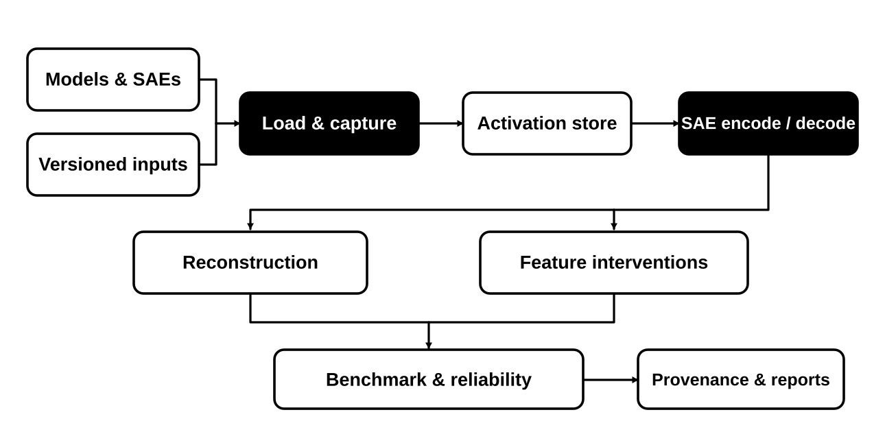

# 🧱 SAEBase: Research Infrastructure for Sparse Autoencoders

🌍 Languages: [English](README.md) | [中文](README_cn.md) &nbsp; [](https://github.com/OpenSAE/SAEBase/actions/workflows/ci.yml)

**Latest software release:** [v0.5.0 Public Research Beta](docs/releases/v0.5.0.md) · [OpenSAE Playground](https://atheavenma.github.io/opensae/workspace.html) · [Python API](docs/python-api.md)

👉 **TL;DR.** SAEBase helps researchers understand, test, and modify sparse autoencoder (SAE) features in language models. Capture activations, evaluate reconstructions, edit features, measure downstream effects, and reproduce results with checkpoint-aware caches.

<p align="center">
  <a href="#-quick-start"><b>🚀 Quick Start</b></a> &nbsp; | &nbsp;
  <a href="#-research-workflows"><b>🔬 Workflows</b></a> &nbsp; | &nbsp;
  <a href="#-research-lab"><b>🧪 Research Lab</b></a> &nbsp; | &nbsp;
  <a href="#-documentation"><b>📚 Documentation</b></a>
</p>

🤗 **Hugging Face:** [SAEBase Research Lab](https://huggingface.co/spaces/OpenSAE/SAEBase) · [Evaluation Dataset](https://huggingface.co/datasets/OpenSAE/SAEBase-Evaluation)

---

## OpenResearch Harness and Unified Research Workspace

This branch integrates the [OpenResearch](https://github.com/OpenSAE/OpenResearch) execution and governance layers **without replacing SAEBase's published v0.5 API, CLI, registries, releases, model catalog, or original datasets**. It is a source-workspace integration under development, not a new public software release.

| Component | Ownership and compatibility |
| --- | --- |
| `saebase/` | Existing public SAEBase primitives, registries, CLI, benchmark and release compatibility remain authoritative. |
| `dlbase/` | OpenResearch's separate Hydra training/execution and Dataset/Model/Task registry. |
| `research_datasets/` | Additive NLP prompt-source implementations; original `saebase/data/` is retained. |
| `models/` | Existing SAEBase model keys remain; `models/LLM/` provides OpenResearch LLM adapters. |
| `tasks/` | Original compatibility plugin interface remains; `tasks/LLM/` adds capture, intervene, generate, circuits, explain, benchmark, and train executors. |
| `harness/` and `.cursor/` | Agent Flow, Core/Knowledge/Code/Environment, Atlas visualization, scoped hooks and skills. |
| `doc/` | Versioned context and Code graph source references, originally derived from OpenResearch; transferred statuses need SAEBase-specific review. |

**Separate entry points.** The existing `saebase` commands and `conf/config.yaml` retain their previous meaning. New DLBase operations use `python -m dlbase.train`, `conf/openresearch.yaml`, and `models/dlbase_plugins.py` / `tasks/dlbase_plugins.py` (original plugin compatibility shims remain intact). Select `model=openresearch_gemma2_2b_base` for the OpenResearch-style Gemma configuration; the original `model=gemma2_2b_base` preset is unchanged.

```bash
# Structural validation, independent of GPU/checkpoint downloads
python .cursor/hooks/validate_repo.py --full

# New task configuration preview. Requires Hydra/Lightning and source checkout.
python -m dlbase.train --cfg job
```

The OpenResearch dataset package is isolated as `research_datasets` so third-party Hugging Face `datasets` and the existing SAEBase loaders keep their original import identity. Real remote dataset access and full Research Lab behavior still require acceptance checks. Model-weight compatibility, GPU inference, Atlas snapshot generation and full original SAEBase regression tests are **not yet certified** in this integration branch.

[Architecture and migration notes](docs/openresearch-integration.md) · [Harness](harness/README.md) · [Atlas sources](harness/visualization/README.md) · [Cursor rules](.cursor/rules/core/00-core.mdc)

## 🧭 Overview

SAEBase connects pretrained models, SAE dictionaries, activation measurements, controlled feature interventions, benchmarks, and reliability analysis in one reusable workflow.

<p align="center">
  
</p>

**Capture once, evaluate multiple SAEs.** Verified activations can be reused across compatible SAE checkpoints at the same model site, without repeating the language-model forward pass.

## ✨ Highlights

- 🧠 **Model and SAE support.** Registered checkpoints, named activation sites, compatible adapters and verified model/SAE identities.
- 🗃️ **Reusable activations.** Resumable sharded caches, lossless SAE codes, selected-token measurements and integrity checks.
- 🎛️ **Feature interventions.** Identity, ablation, scaling, clamping, addition, coalitions and reconstruction, with downstream logit and behavioral readouts.
- ⚡ **Faster experiments.** Opt-in suffix replay and KV-cached steering, including live tokenwise SAE edits and vLLM decoder-direction steering.
- 📊 **Benchmarking and reliability.** Reconstruction, sparsity and behavioral metrics, paired comparisons, prompt-group bootstrap and negative controls.
- 🧩 **Research integrations.** Original SAR and RSS estimators, Input Localization and verified imports of native SAEBench results.

## 🧪 Research Lab

The [Research Lab](https://huggingface.co/spaces/OpenSAE/SAEBase) displays public SAE measurements and reports. The table also includes results recorded in separate GPU experiments.

| Research area | Recorded evidence |
| --- | --- |
| Model and SAE coverage | 48 selected sites, 500 frozen parent prompts |
| Feature exploration | 300 statistical feature cards across six deep-dive sites |
| Interventions | Six real model/SAE sites with clean and edited logits |
| SAR | 1,485 measured K16 groups, 14 K8 groups and one K4 group |
| RSS | 138,000 records of clean inputs and proposed variants across six sites |
| Input Localization | One 64-state input grid and 55 observed features |

[**Open the Research Lab**](https://huggingface.co/spaces/OpenSAE/SAEBase) · [Dataset](https://huggingface.co/datasets/OpenSAE/SAEBase-Evaluation) · [Recorded results](docs/research-lab/results-20261020.md) · [Software release notes](docs/releases/v0.4.0.md)

## 🚀 Quick Start

### 1. Install and run a complete example

Use Python 3.11 or 3.12. The first examples run on CPU without downloading model checkpoints.

```bash
git clone https://github.com/OpenSAE/SAEBase.git
cd SAEBase
python -m pip install -e .

python examples/quickstart/public_api_offline.py
python examples/quickstart/first_experiment.py --output runs/first-experiment
```

The first Python example demonstrates activation capture and a feature edit. The second example evaluates two small synthetic SAEs and writes `report.html`, `summary.csv` and a reliability report. It prints the exact output paths so you can open the HTML report in a browser.

### 2. Try a real model and SAE

Install the optional model dependencies, then run the provided Pythia-70M example. This downloads public model and SAE weights.

```bash
python -m pip install -e ".[analysis]"
python examples/interventions/pythia_feature_edit.py
```

Use the same operations directly in Python:

```python
from saebase.api import (
    load_registered, capture_features, coalition_replacements, evaluate_edit,
)

bundle = load_registered(
    model_key="pythia70m", sae_key="pythia70m_resid_sm", layer=3, device="cpu"
)
tokens = bundle.model.tokens(prompt="Alice Emma Alice")
snapshot = capture_features(bundle.model, bundle.sae, site=bundle.site, tokens=tokens)
features = snapshot.codes.abs().topk(4).indices.tolist()
replacement = coalition_replacements(
    snapshot.codes, selected_indices=features, retained_indices=features[:2]
)
effect = evaluate_edit(
    bundle.model, bundle.sae, site=bundle.site, tokens=tokens, replacements=replacement
)
print(float(effect.logit_delta.float().norm()))
```

This removes two selected feature contributions and reports the change in next-token logits. For other checkpoints, token selection and editing operations, see the [Python API](docs/python-api.md) and [model registry](docs/model-support.md).

## 🔬 Research Workflows

SAEBase separates what gets measured from how the results are analyzed.

| Goal | Runnable example | Guide |
| --- | --- | --- |
| Capture and reuse activations | [Activation store](examples/activations/activation_store.py) | [Capture and storage](docs/activation-store.md) |
| Test feature interventions | [Batch interventions](examples/interventions/batch_interventions.py) | [Feature editing and steering](docs/feature-interventions.md) |
| Benchmark and audit results | [First experiment](examples/quickstart/first_experiment.py) | [Benchmarking](docs/benchmarking.md) · [Reliability](docs/reliability.md) |
| Integrate research methods | [Research examples](examples/research_integrations/README.md) | [SAR, RSS, Localization and SAEBench](docs/research-integrations.md) |

Feature edits can preserve the part of an activation not reconstructed by the SAE:

```text
edited_activation = original_activation + decode(edited_codes) - decode(original_codes)
```

Full SAE reconstruction is a separate experimental control. Reliability estimates resample independent prompt groups rather than treating related token variants as independent observations.

### ⚡ Measured acceleration

On one RTX 5070 with Qwen3-1.7B Base, opt-in block-suffix replay accelerated the **complete 25-sample × 7-condition intervention workload by 1.28×**, with unchanged reported metrics. For 128-token generation, live SAE editing with a KV cache achieved **89 tokens/s**, and vLLM SAE decoder-direction steering achieved **158 tokens/s**. The generation paths use distinct steering protocols.

[Full GPU results](docs/performance/workplan11_final_results.md) · [Execution details](docs/performance.md)

## 🧠 Model and SAE Support

<!-- BEGIN VERIFIED_MODEL_SUPPORT -->
**Verified checkpoints (2026-10-16).** Across **18** model-SAE configurations (270M-9B), **48/48** selected model/layer sites passed real-checkpoint compatibility tests, **48/48** completed benchmark evaluations on 64 held-out prompt groups, and **48/48** completed reliability audits. See the [verified model and SAE matrix](docs/verified-model-matrix.md).
<!-- END VERIFIED_MODEL_SUPPORT -->

The reported compatibility, benchmark and reliability checks use the recorded reference protocol; registered checkpoints are not automatically equivalent across all backends. [Model/SAE matrix](docs/verified-model-matrix.md) · [Validation](docs/validation.md)

## 📚 Documentation

[Getting Started](docs/getting-started.md) · [Python API](docs/python-api.md) · [Examples](examples/README.md) · [Research Lab](apps/research-lab/README.md) · [Full documentation](docs/index.md)

The repository is organized by use: `saebase/` for the research API and engines, `models/` for adapters, `conf/` for configurations, `examples/` for runnable tasks, `assets/` for figures and branding, and `docs/` for guides and reproducible evidence. Historical validation scripts and work plans remain available separately from the Quick Start. See [Repository Guide](docs/repository-guide.md).

[Contributing](CONTRIBUTING.md) · [Changelog](CHANGELOG.md) · [Citation](CITATION.cff) · [Apache-2.0 License](LICENSE) · [Security](SECURITY.md)

---

<p align="center">
  <b>From learned features to testable explanations.</b><br>
  <a href="https://github.com/OpenSAE">OpenSAE</a> · <a href="https://github.com/OpenSAE/SAEBase/issues">Issues</a>
</p>
