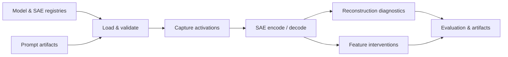

# 🧱 SAEBase: Research Infrastructure for Sparse Autoencoders

🌍 Languages: [English](README.md) | [中文](README_cn.md) &nbsp; [](https://github.com/OpenSAE/SAEBase/actions/workflows/ci.yml)

👉 **TL;DR.** SAEBase unifies model and SAE loading, prompt datasets, activation analysis, feature interventions, and reproducible evaluation into one research toolkit.

<p align="center">
  <a href="#-quickstart"><b>🚀 Quickstart</b></a> &nbsp; | &nbsp;
  <a href="#-public-python-api"><b>🔬 Python API</b></a> &nbsp; | &nbsp;
  <a href="#-research-integrations"><b>🧩 SAR & RSS</b></a> &nbsp; | &nbsp;
  <a href="#-documentation"><b>📚 Documentation</b></a>
</p>

---

## 🧭 Overview

SAEBase provides common infrastructure for investigating learned representations, measuring activation-level properties, and evaluating the behavioral effects of SAE features.



## ✨ Highlights

- 🧠 **Model and SAE registry.** Model configurations, checkpoint profiles, layers, hooks, and compatibility checks in a shared interface.
- 🔎 **Activation analysis.** Capture activations, inspect SAE codes, and measure L0, activation norms, reconstruction error, and explained variance.
- 🎛️ **Feature interventions.** Edit SAE codes, patch selected activation sites, and compare downstream logits while retaining reconstruction residuals.
- 🗂️ **Reproducible prompts.** Versioned JSONL datasets and manifests with consistent model, behavior, and seed metadata.
- 🧩 **Research integrations.** Shared capture and intervention tools for [SAR](https://github.com/OpenSAE/SAE-Behavioral-Compositionality) and [RSS](https://github.com/OpenSAE/Redistribution-Sensitivity-Score), using their original estimators.
- ⚙️ **Reusable tooling.** Python API, command-line utilities, Hydra configurations, tests, and distributable packages.

---

## ⚙️ Install

Install the standard analysis environment from a source checkout (Python 3.11–3.12):

```bash
git clone https://github.com/OpenSAE/SAEBase.git
cd SAEBase
python -m pip install -e ".[analysis]"
saebase --list
```

<details>
<summary>📦 Other installation options</summary>

The lightweight environment supports the registries, CLI, and offline public API:

```bash
python -m pip install -e .
```

For tests and packaging, use `pip install -e ".[dev]"`. For experimental GPU generation backends, see `.[generation]` and [the runtime notes](docs/PHASE_C.md).

</details>

## 🚀 Quickstart

**1. Prepare prompts** with the registered Pythia-70M model:

```bash
saebase-prepare-prompts \
  --model-key pythia70m --behavior SimpleCopying \
  --device cpu --n-generate 300 --min-kept 20 --seed 0 \
  --data-dir ./data
```

This creates `prompts.jsonl` and `manifest.json` in `data/SimpleCopying/pythia70m/v1/`.

**2. Evaluate a public SAE** at layer 3:

```bash
saebase \
  --task sae --model pythia70m --sae pythia70m_resid_sm \
  --prompt-source SimpleCopying --layer 3 --n-prompts 5 \
  --data-dir ./data --device cpu \
  --run-dir ./experiment/pythia70m-smoke
```

The evaluation saves `sae_activation_summary.json` with per-prompt diagnostics and Hydra run configuration. This workflow downloads the requested public model and SAE checkpoints.

💻 **End-to-end acceptance:** `bash scripts/phase_a_smoke.sh`. Set `DEVICE=cuda` for a configured GPU environment.

---

## 🔬 Public Python API

Run the self-contained **offline example**, which uses a small synthetic model and SAE:

```bash
python examples/05_public_api_offline.py
```

The public interface in [`saebase.api`](saebase/api/__init__.py) provides activation sites, model adapters, SAE provenance, feature capture, code editing, and baseline-versus-patched logit evaluation.

Feature edits follow:

```text
edited_activation = original_activation + decode(edited_codes) - decode(original_codes)
```

This keeps the original activation's reconstruction residual. Identity replay checks verify the unedited model output.

For a real Pythia checkpoint example, run `python examples/06_public_api_pythia.py`.

## 🧩 Research Integrations

SAEBase supplies shared model operations; each research project retains its own metric and experimental definition.

| Project | Use of SAEBase | Example |
| :--- | :--- | :--- |
| 🧩 **[SAR — Behavioral Compositionality](https://github.com/OpenSAE/SAE-Behavioral-Compositionality)** | Capture feature contributions, apply coalition interventions, and call the original SAR estimator. | [SAR integration](examples/07_sar_via_saebase.py) |
| 🔀 **[RSS — Representation Redistribution](https://github.com/OpenSAE/Redistribution-Sensitivity-Score)** | Capture clean, selection, and held-out activations and call the original RSS estimator. | [RSS integration](examples/08_rss_via_saebase.py) |

Run the integration demos with local copies of the original research repositories:

```bash
python examples/07_sar_via_saebase.py --paper-dir /path/to/SAR-repo
python examples/08_rss_via_saebase.py --paper-dir /path/to/RSS-repo
```

Both examples default to deterministic synthetic data. The `--real` option uses public checkpoints. See [integration details](docs/PHASE_C.md).

---

## 🏗️ Architecture

| Component | Responsibility |
| :--- | :--- |
| [`saebase/api/`](saebase/api/) | Model adapters, activation capture, feature editing, intervention results |
| [`saebase/sae/`](saebase/sae/) | Checkpoint profiles, SAE loading, activation diagnostics |
| [`saebase/data/`](saebase/data/) | Prompt preparation, compatibility matrix, JSONL and manifest I/O |
| [`models/`](models/) · [`conf/`](conf/) | Model plugins and Hydra configurations |
| [`tasks/`](tasks/) · [`scripts/`](scripts/) | Registered evaluation tasks, preparation and runtime checks |

## ✅ Validation

Run the offline test suite:

```bash
python -m pip install -e ".[dev]"
python -m pytest -q
```

| Area | Validation |
| :--- | :--- |
| Registry, prompt artifacts, and core public API | Automated offline tests |
| Activation capture and intervention adapters | Synthetic backend and small-model checks |
| SAR and RSS integrations | Offline contracts against original estimator interfaces |
| Pythia / Gemma public checkpoints | Registered with opt-in real-model acceptance scripts |
| vLLM / NNsight backends | Optional experimental backends; GPU acceptance tracked separately |

<details>
<summary>🔧 Runtime and compatibility details</summary>

- The current bundled executable evaluation is `task=sae` with `activation_health`.
- Additional protocol configurations are retained as references; their original task implementations belong to the source research workspace.
- Real-model examples download the requested weights and require the corresponding model/SAE dependencies.
- Registry inspection works with `python -m saebase.sae.verify_registry --list`.
- The source distribution includes CLI commands and versioned Hydra configuration resources.

</details>

---

## 📚 Documentation

[API Reference](docs/API.md) · [Getting Started](docs/PHASE_A.md) · [Feature Interventions](docs/PHASE_B.md) · [Research Integrations](docs/PHASE_C.md) · [Changelog](CHANGELOG.md)

[Contributing](CONTRIBUTING.md) · [Provenance](docs/PROVENANCE.md) · [Release Checklist](docs/RELEASE_CHECKLIST.md) · [Security](SECURITY.md) · [Apache-2.0 License](LICENSE)

<p align="center">
  <b>Open research infrastructure for faithful representation analysis.</b><br>
  <a href="https://github.com/OpenSAE">OpenSAE</a> · <a href="https://github.com/OpenSAE/SAEBase/issues">Issues & contributions</a>
</p>
