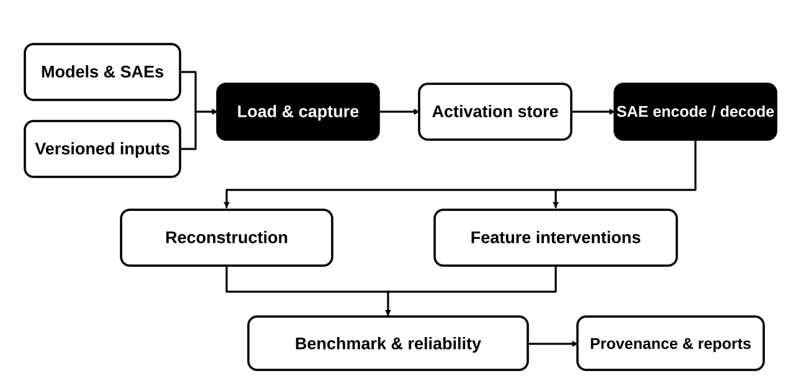

# 🧱 SAEBase: SAE Research Tools and Agent Workflows

🌍 Languages: [English](README.md) | [中文](README_cn.md) &nbsp; [](https://github.com/OpenSAE/SAEBase/actions/workflows/ci.yml)

**Software version:** [v0.7.0 — Component Workflows and Reusable Experiments](doc/code/development/releases/v0.7.0.md) · [Research Lab](https://huggingface.co/spaces/OpenSAE/SAEBase) · [Python API](doc/code/development/python-api.md)

**SAEBase** helps researchers study sparse autoencoders (SAEs) in language models. Explore features, test how feature edits affect model behavior, and build reproducible experiments.

<p align="center">
  <a href="https://huggingface.co/spaces/OpenSAE/SAEBase"><b>🤗 Research Lab</b></a> &nbsp; | &nbsp;
  <a href="https://huggingface.co/datasets/OpenSAE/SAEBase-Evaluation"><b>🤗 Evaluation Dataset</b></a>
</p>

---

## 🧭 Overview

SAEBase connects pretrained models, SAE dictionaries, activation measurements, controlled feature interventions, benchmarks, and reliability analysis in one reusable workflow.

<p align="center">
  
</p>

**Capture once, evaluate multiple SAEs.** Verified activations can be reused across compatible SAE checkpoints at the same model site, without repeating the language-model forward pass.

## ✨ Highlights

- **Explore SAE features.** Capture model activations, inspect sparse feature codes, and compare reconstructions.
- **Test interventions.** Ablate, scale, add, or replace selected features and measure the effect on model outputs.
- **Reuse measurements.** Cache activations, resume interrupted work, and compare compatible model and SAE checkpoints.
- **Evaluate results.** Run reconstruction and behavior measurements with controls and reproducible reports.
- **Work with agents.** Give coding agents scoped research tasks and independently review their implementations and outputs.
- **Extend your research.** Connect datasets, models, tasks, and established research methods through the existing interfaces.

## 🧪 Research Lab

The [Research Lab](https://huggingface.co/spaces/OpenSAE/SAEBase) lets you browse recorded SAE research results, feature measurements, intervention examples, and reports. Recorded results are distinguished from illustrative examples and new computations. Fresh model inference requires a separately configured runtime and appropriate weights.

[Open the Research Lab](https://huggingface.co/spaces/OpenSAE/SAEBase) · [Evaluation Dataset](https://huggingface.co/datasets/OpenSAE/SAEBase-Evaluation) · [Measured results and methods](doc/code/development/research-lab/results-20261020.md)

## 🚀 Quick Start

### 1. Install and run a complete example

Use Python 3.11 or 3.12. The first examples run on CPU without downloading model checkpoints.

```bash
git clone https://github.com/OpenSAE/SAEBase.git
cd SAEBase
python -m pip install -e .

python scripts/examples/first_experiment.py --dry-run
python scripts/examples/first_experiment.py --output runs/first-experiment
```

The first Python example demonstrates activation capture and a feature edit. The second example evaluates two small synthetic SAEs and writes `report.html`, `summary.csv` and a reliability report. It prints the exact output paths so you can open the HTML report in a browser.

### 2. Try a real model and SAE

SAEBase uses a single master configuration, [conf/config.yaml](conf/config.yaml), to select models, datasets and peer tasks. These commands inspect configuration without loading weights or running an evaluation:

```bash
saebase task=capture --cfg job
saebase task=benchmark --cfg job
```

Select components with `model=... dataset=... task=...`, then supply the selected task's parameters. Benchmark does not manage other tasks. See the [current architecture](doc/code/development/current-architecture.md).

Install the optional model dependencies, then run the provided Pythia-70M example. This downloads public model and SAE weights.

```bash
python -m pip install -e ".[analysis]"
python -m saebase.api.reference --device cpu
```

Use the same operations directly in Python:

```python
from saebase.api import (
    load_registered, capture_features, coalition_replacements, evaluate_edit,
)

bundle = load_registered(
    model_key="pythia70m", sae_key="pythia70m_resid_sm", layer=3, device="cpu"
)
tokens = bundle.model.tokens(prompt="Alice Emma Alice")
snapshot = capture_features(bundle.model, bundle.sae, site=bundle.site, tokens=tokens)
features = snapshot.codes.abs().topk(4).indices.tolist()
replacement = coalition_replacements(
    snapshot.codes, selected_indices=features, retained_indices=features[:2]
)
effect = evaluate_edit(
    bundle.model, bundle.sae, site=bundle.site, tokens=tokens, replacements=replacement
)
print(float(effect.logit_delta.float().norm()))
```

This removes two selected feature contributions and reports the change in next-token logits. For other checkpoints, token selection and editing operations, see the [Python API](doc/code/development/python-api.md) and [model registry](doc/code/development/model-support.md).

### 3. Work with a coding agent

Open the source checkout in your coding-agent environment and start with [AGENTS.md](AGENTS.md) for component responsibilities and development guidance. SAEBase's core Python software runs independently.

## 🔬 Research Workflows

SAEBase separates what gets measured from how the results are analyzed.

| Goal | Runnable example | Guide |
| --- | --- | --- |
| Capture and reuse activations | [Activation store](doc/code/development/activation-store.md) | [Capture and storage](doc/code/development/activation-store.md) |
| Test feature interventions | [Batch interventions](doc/code/development/feature-interventions.md) | [Feature editing and steering](doc/code/development/feature-interventions.md) |
| Benchmark and audit results | [First experiment](scripts/examples/first_experiment.py) | [Benchmarking](doc/code/development/benchmarking.md) · [Reliability](doc/code/development/reliability.md) |
| Integrate research methods | [Research examples](doc/code/development/research-integrations.md) | [SAR, RSS, Localization and SAEBench](doc/code/development/research-integrations.md) |

Feature edits can preserve the part of an activation not reconstructed by the SAE:

```text
edited_activation = original_activation + decode(edited_codes) - decode(original_codes)
```

Full SAE reconstruction is a separate experimental control. Reliability estimates resample independent prompt groups rather than treating related token variants as independent observations.

### ⚡ Performance

SAEBase includes optional optimizations for repeated model evaluations and feature interventions. Results and hardware conditions are documented separately in the [performance report](doc/code/development/performance/workplan11_final_results.md).

## 🧠 Model and SAE Support

<!-- BEGIN VERIFIED_MODEL_SUPPORT -->
**Verified checkpoints (2026-10-16).** Across **18** model-SAE configurations (270M-9B), **48/48** selected model/layer sites passed real-checkpoint compatibility tests, **48/48** completed benchmark evaluations on 64 held-out prompt groups, and **48/48** completed reliability audits. See the [verified model and SAE matrix](doc/code/development/verified-model-matrix.md).
<!-- END VERIFIED_MODEL_SUPPORT -->

[Model/SAE matrix](doc/code/development/verified-model-matrix.md) · [Validation methods](doc/code/development/validation.md)

## 📚 Documentation

[Getting Started](doc/code/development/getting-started.md) · [Python API](doc/code/development/python-api.md) · [Examples](doc/code/development/first-experiment.md) · [Research Lab](saebase/research_lab/README.md) · [Full documentation](doc/code/development/index.md)

Explore the code: [SAEBase API](saebase/) · [Models](models/) · [Datasets](datasets/) · [Tasks](tasks/) · [Configuration](conf/) · [Repository Guide](doc/code/development/repository-guide.md).

[Contributing](.github/CONTRIBUTING.md) · [Changelog](doc/code/development/CHANGELOG.md) · [Citation](CITATION.cff) · [Apache-2.0 License](LICENSE) · [Security](.github/SECURITY.md)

---

<p align="center">
  <em>Building open foundations for understanding and evaluating LLMs.</em><br>
  <a href="https://github.com/OpenSAE">OpenSAE</a> · <a href="https://github.com/OpenSAE/SAEBase/issues">Issues</a>
</p>
