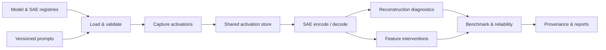

# 🧱 SAEBase: Research Infrastructure for Sparse Autoencoders

🌍 Languages: [English](README.md) | [中文](README_cn.md) &nbsp; [](https://github.com/OpenSAE/SAEBase/actions/workflows/ci.yml)

👉 **TL;DR.** SAEBase is an open-source toolkit for reproducible sparse autoencoder research. Load models and SAEs, capture and reuse activations, intervene on features, benchmark reconstruction and downstream effects, and audit results with verifiable provenance.

<p align="center">
  <a href="#-quickstart"><b>🚀 Quickstart</b></a> &nbsp; | &nbsp;
  <a href="#-public-python-api"><b>🔬 Python API</b></a> &nbsp; | &nbsp;
  <a href="#-research-integrations"><b>🧩 Research Integrations</b></a> &nbsp; | &nbsp;
  <a href="#-documentation"><b>📚 Documentation</b></a>
</p>

---

## 🧭 Overview

SAEBase provides a common research workflow for evaluating sparse autoencoders (SAEs) beyond reconstruction alone. It connects pretrained models, SAE dictionaries, versioned input samples, activation-level measurements, controlled feature edits, and statistical reliability checks without conflating their results.



The workflow is **capture once, evaluate multiple SAEs**: a verified activation cache can be reused by different SAE checkpoints at the same model site. Feature edits can then be measured against original model outputs, and independently interpretable metrics are reported without producing a single composite SAE score.

## ✨ Highlights

- 🧠 **Model and SAE integration.** Unified checkpoint profiles, model adapters, layers, named hooks, compatibility checks, and identities for registered or custom SAEs.
- 🧭 **Controlled input designs.** Enumerate complete binary factor grids, track state-to-sample mappings, and reuse cached activations under bijective input reindexing.
- 🗃️ **Activation capture and reuse.** Sharded, resumable activation stores; lossless dense/CSR SAE codes; exact token selection, sample groups, splits, and checkpoint SHA-256 verification.
- 🎛️ **Feature interventions and steering.** Identity, ablation, scaling, clamping, addition, coalition, and full-reconstruction controls, with batch evaluation and downstream logit readouts. Feature edits can preserve the original reconstruction residual.
- 📊 **SAE benchmarking.** Separate L0, reconstruction MSE, FVU/explained variance, token-level behavioral loss, logit/KL changes, localization budgets and condition-specific metrics under reproducible configurations.
- 📈 **Reliability analysis.** Prompt-group bootstrap, paired SAE comparisons, confidence intervals, sample-size curves, ranking stability, and analytical ground-truth/negative-control tests.
- 🧩 **Research integrations.** Original [SAR](https://github.com/OpenSAE/SAE-Behavioral-Compositionality) and [RSS](https://github.com/OpenSAE/Redistribution-Sensitivity-Score) and [Input Localization](https://github.com/OpenSAE/SAE-Input-Localization) estimators plus provenance-checked imports of native SAEBench outputs.
- ⚙️ **Reproducible experiments.** Compute preflight, exact cache identities, interrupted-run recovery, source/checkpoint hashes, and standalone JSONL/JSON, CSV, and HTML reports.

---

## ⚙️ Install

SAEBase supports Python 3.11–3.12. Install the analysis environment from a source checkout to run real model/SAE experiments:

```bash
git clone https://github.com/OpenSAE/SAEBase.git
cd SAEBase
python -m pip install -e ".[analysis]"
saebase --list
```

<details>
<summary>📦 Other installation options</summary>

For registries, offline examples, and the lightweight core API:

```bash
python -m pip install -e .
```

For tests and packaging, install `.[dev]`. Optional experimental GPU generation integrations use `.[generation]`; GPU vLLM/NNsight acceleration is not part of the default verified CPU workflow. Versioned wheels and source archives are available under [GitHub Releases](https://github.com/OpenSAE/SAEBase/releases); this project does not claim a PyPI upload.

</details>

## 🚀 Quickstart

**1. Explore the public API without downloading checkpoints:**

```bash
python examples/05_public_api_offline.py
```

This self-contained example uses a small synthetic model and SAE to demonstrate activation capture, feature editing, identity checks, and downstream logit comparisons. Its numerical outputs are not research findings.

**2. Inspect a benchmark before committing compute:**

```bash
saebase-benchmark --config conf/benchmark/p0_small.json --dry-run
```

This validates the experiment, its measurement count, and the execution dependencies without loading model weights.

**3. Run the same configuration using public checkpoints:**

```bash
saebase-benchmark --config conf/benchmark/p0_small.json --real
saebase-benchmark --config conf/benchmark/p0_small.json --report-only
```

Real runs download the requested weights and produce `metrics.jsonl`, `summary.csv`, `report.html`, configuration, and provenance under `runs/<run_id>/`. This tiny fixed-token example is an engineering smoke test, not a study dataset. For prompt preparation and the original activation-health command, see [Getting Started](docs/getting-started.md).

---

## 🧠 Model and SAE Support

**Open SAE coverage from 270M to 9B.** [Stages B+C](docs/stage-bc-model-sae-coverage.md) organize 15 representative models, three complementary SAE architectures and 48 selected layer checkpoints. **21/21 selected SAE checkpoints have passed genuine CPU weight and encode/decode acceptance**, with full artifact hashes. Real model–SAE capture, feature ablation, Benchmark and Reliability have also passed for Pythia 410M, Qwen3 1.7B Base and DeepSeek-R1-Distill-Qwen 1.5B, alongside Qwen3.5 2B. Larger model-pair runs remain for Stage D. See the [full model and SAE matrix](docs/stage-bc-model-sae-coverage.md) and [Phase A evidence](docs/phase-a-model-coverage.md).


SAEBase can register many model/SAE configurations, but **registration is not evidence of runtime validation**. The published real-checkpoint acceptance uses:

| Model | Verified activation site | Real SAE checkpoints exercised |
| :--- | :--- | :--- |
| **Pythia-70M (deduped)** | `blocks.3.hook_resid_post` | Residual-stream SAE and a separately trained gated SAE |
| **GPT-2 Small** | `blocks.8.hook_resid_pre` | Original residual SAE and feature-splitting SAE |

Both model families were executed with two distinct SAE checkpoint weight hashes and six fixed prompts per model. Additional model profiles, including Gemma and larger checkpoints, are available in the registry but may require other dependencies, access permissions, hardware, or separate acceptance. See [Supported Models and Checkpoints](docs/model-support.md).

---

## 🗃️ Activation Capture and Storage

Capture model activations once and reuse the stored rows when evaluating multiple SAEs at the same hook. The store records the model and tokenizer identity, selected token positions, `sample_id`, `prompt_group_id`, split, and source activation checksums. SAE codes are stored separately in lossless dense or CSR representations.

```bash
python examples/10_activation_store_offline.py
```

Readers verify manifests and shards, and interrupted runs can resume instead of repeating committed captures. Reuse is conditional on exact model/site/input identities; it is never inferred solely from a file name. See [Activation Store](docs/activation-store.md).

---

## ⚡ Feature Interventions and Steering

SAEBase supports batched identity, ablation, scaling, clamping, addition, coalition, and reconstruction conditions. Feature-level edits can use residual-preserving patching:

```text
edited_activation = original_activation + decode(edited_codes) - decode(original_codes)
```

A **full SAE reconstruction replacement** is a separate experimental control and must not be confused with residual-preserving feature edits. Results distinguish interventions by condition and include downstream logits, KL divergence, target-token effects (when defined), and activation changes.

```bash
saebase-intervene --config conf/interventions/m2_pythia_example.json --dry-run
python examples/11_batch_interventions_offline.py
```

Real checkpoint execution requires `--real`. Short-text steering uses reference full-prefix recomputation; no KV-cache or GPU throughput speedup is implied. See [Feature Interventions](docs/feature-interventions.md).

---

## 📊 SAE Benchmarking

The benchmark runner expands model/SAE/metric configurations into a deterministic plan, reuses identity-verified activation/code and intervention caches, and emits each metric with its own units, protocol, sample counts, status, and source provenance.

| Metric family | Examples | Interpretation |
| :--- | :--- | :--- |
| **Core representations** | L0, reconstruction MSE, FVU, explained variance | SAE sparsity and reconstruction properties; denominator/protocol definitions matter |
| **Behavioral reconstruction** | Target-token negative log-likelihood, loss recovered | Full reconstruction relative to the unmodified model and a measured zero-site ablation |
| **Feature interventions** | Logit differences, KL, activation delta, target-token changes | Downstream effects for individual, named edit conditions |
| **External research metrics** | SAR, RSS, native SAEBench Core and Sparse Probing | Original estimators or original externally generated results, with source and protocol checks |

```bash
saebase-benchmark --config conf/benchmark/p0_small.json --dry-run
python examples/12_benchmark_offline.py
```

SAEBase's per-token FVU is not automatically numerically interchangeable with SAEBench's global reconstruction protocol. Native SAEBench metrics are **imported from an upstream-generated JSON result**; the benchmark importer does not silently rerun upstream evaluations. See [Benchmarking](docs/benchmarking.md).

---

## 📈 Reliability and Reproducibility

Reliability audits reuse already computed measurements and resample complete **prompt groups**, keeping tokens or prompt variants within the same independent group. They report paired confidence intervals, subsample-size sensitivity, ranking stability for metrics with a meaningful direction, and explicitly undefined or unsupported comparisons.

```bash
python examples/13_reliability_offline.py
python examples/14_ground_truth_offline.py
```

To audit a completed benchmark, run `saebase-audit --m3-root runs/<run_id> --config conf/reliability/m4_pythia_smoke.json --run --sae-only`. Use a matching multi-prompt benchmark run for this audit. The legacy `--m3-root` flag is retained for CLI compatibility; it refers to the benchmark's output directory, not a required workflow stage.

Analytical controls include known factor dictionaries, coalition interaction orders, RSS support/direction persistence, controllable degradation, and negative controls. These synthetic tests **do not certify the interpretability of a real SAE**. For reconstruction uncertainty, `--sae-only` can decode verified cached codes without re-running the language model. See [Reliability Analysis](docs/reliability.md).

---

## 🧩 Research Integrations

SAEBase supplies shared model operations; original research projects retain their own metric definitions and scientific protocols.

| Project | SAEBase integration | Example |
| :--- | :--- | :--- |
| 🧩 **[SAR — Behavioral Compositionality](https://github.com/OpenSAE/SAE-Behavioral-Compositionality)** | Capture feature contributions, apply coalition edits, call the unchanged SAR estimator. | [SAR example](examples/07_sar_via_saebase.py) |
| 🔀 **[RSS — Representation Redistribution](https://github.com/OpenSAE/Redistribution-Sensitivity-Score)** | Capture disjoint clean/selection/held-out observations, call the unchanged RSS estimator. | [RSS example](examples/08_rss_via_saebase.py) |
| 🧭 **[Input Localization](https://github.com/OpenSAE/SAE-Input-Localization)** | Capture or reuse complete, ordered Boolean input grids of SAE codes; delegate optimal scope curves to the original Localize package. | [Localize example](examples/15_input_localization_via_saebase.py) |
| 📊 **[SAEBench](https://github.com/adamkarvonen/SAEBench)** | Import and verify selected native Core and Sparse Probing result fields against the original model/SAE identity and upstream commit. | [Benchmark documentation](docs/benchmarking.md) |

```bash
python examples/07_sar_via_saebase.py --paper-dir /path/to/SAR-repo
python examples/08_rss_via_saebase.py --paper-dir /path/to/RSS-repo
```

The examples use deterministic synthetic inputs by default; real checkpoint use is opt-in. For Localize, install the independent `sae-input-localization` package first and run `python examples/15_input_localization_via_saebase.py`. Try the cached, reindexed grid via `python examples/16_controlled_input_design.py` (no model downloads). See [Controlled Input Designs](docs/controlled-inputs.md), [Localize Benchmarking](docs/localization-benchmark.md), and [Research Integrations](docs/research-integrations.md).

---

## 🔬 Public Python API

The stable `saebase.api` includes `ModelAdapter`, `ActivationSite`, `load_registered`, `capture_features`, `edit_features`, and `evaluate_edit`. Research workflows can also use `saebase.store`, `saebase.interventions`, `saebase.benchmarks`, and `saebase.reliability` directly.

```python
from saebase.api import load_registered, capture_features, evaluate_edit

pair = load_registered(model_key="pythia70m",
                       sae_key="pythia70m_resid_sm", layer=3, device="cpu")
snapshot = capture_features(pair.model, pair.sae,
                            site=pair.site, prompt="Alice Emma Alice")
# See examples/06_public_api_pythia.py for a complete feature-edit example.
```

The code above downloads real weights. Prefer the offline example for a no-network start. See the complete [Python API Guide](docs/python-api.md), [API Reference](docs/API.md), and [Examples Index](examples/README.md).

---

## 🏗️ Architecture

| Component | Responsibility |
| :--- | :--- |
| [`saebase/api/`](saebase/api/) | Model adapters, capture/edit functions, activation sites and SAE identity |
| [`saebase/store/`](saebase/store/) | Identity-bound activation/code shards, storage readers and resumable capture |
| [`saebase/interventions/`](saebase/interventions/) | Batch conditions, measurement journals, patch execution and steering |
| [`saebase/benchmarks/`](saebase/benchmarks/) | Metric registry, experiment planning, cached execution and reports |
| [`saebase/reliability/`](saebase/reliability/) | Grouped bootstrap, paired comparisons, ground truth and audits |
| [`saebase/integrations/`](saebase/integrations/) | Original SAR/RSS/Localize interface adapters and controlled-grid benchmark analysis |
| [`saebase/sae/`](saebase/sae/) | SAE profiles, loading and reconstruction diagnostics |
| [`saebase/data/`](saebase/data/) | Versioned prompt data, complete controlled input designs, manifests and compatibility contracts |
| [`models/`](models/) · [`conf/`](conf/) | Model plugins and versioned experiment configurations |
| [`scripts/`](scripts/) · [`examples/`](examples/) | CLIs, executable demonstrations and validation utilities |

## ✅ Validation

```bash
python -m pip install -e ".[dev]"
python -m pytest -q
```

| Area | Publicly validated scope |
| :--- | :--- |
| Core APIs and packaging | Python 3.11/3.12 CI, wheel/sdist construction and installation checks |
| Real model/SAE interoperability | Pythia-70M and GPT-2 Small, two distinct public SAE checkpoints per model |
| Storage, interventions and reports | Identity-aware cache reuse, condition-specific evaluation, resume and integrity checks |
| Research estimators | Original SAR/RSS estimator tests; Localize delegation contracts and pinned native SAEBench Core/Sparse Probing checks |
| Reliability | Prompt-group bootstrap, paired comparisons and independently generated analytical controls |
| Experimental backends | vLLM/NNsight remain optional; this release does not claim GPU throughput validation |

The published multi-checkpoint run uses six fixed prompts per model and is **engineering acceptance**, not large-sample evidence about SAE quality. Checkpoint and dataset licenses remain with their original publishers; model weights are not bundled in the GitHub Release. See [Validation and Evidence](docs/validation.md) and [Release Notes](docs/releases/v0.2.0.md).

---

## 📚 Documentation

[Documentation Index](docs/index.md) · [Getting Started](docs/getting-started.md) · [Python API](docs/python-api.md) · [Examples](examples/README.md) · [Model Support](docs/model-support.md)

[Activation Store](docs/activation-store.md) · [Feature Interventions](docs/feature-interventions.md) · [Benchmarking](docs/benchmarking.md) · [Reliability](docs/reliability.md) · [Research Integrations](docs/research-integrations.md)

[Validation](docs/validation.md) · [Changelog](CHANGELOG.md) · [Release Notes](docs/releases/v0.2.0.md) · [Provenance](docs/PROVENANCE.md) · [Contributing](CONTRIBUTING.md) · [Security](SECURITY.md) · [Apache-2.0 License](LICENSE)

<p align="center">
  <b>Open research infrastructure for faithful representation analysis.</b><br>
  <a href="https://github.com/OpenSAE">OpenSAE</a> · <a href="https://github.com/OpenSAE/SAEBase/issues">Issues & contributions</a>
</p>
