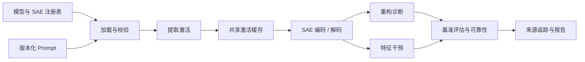

# 🧱 SAEBase：稀疏自编码器研究基础设施

🌍 语言：[English](README.md) | [中文](README_cn.md) &nbsp; [](https://github.com/OpenSAE/SAEBase/actions/workflows/ci.yml)

👉 **一句话总结。** SAEBase 为稀疏自编码器（SAE）研究提供可复现的公共工具：统一加载模型与 SAE、提取并复用激活、干预特征、评估重构及下游行为，并用可验证的来源记录与统计审计报告结果。

<p align="center">
  <a href="#-快速上手"><b>🚀 快速上手</b></a> &nbsp; | &nbsp;
  <a href="#-公共-python-api"><b>🔬 Python API</b></a> &nbsp; | &nbsp;
  <a href="#-研究项目接入"><b>🧩 研究集成</b></a> &nbsp; | &nbsp;
  <a href="#-文档"><b>📚 文档</b></a>
</p>

---

## 🧭 概览

SAEBase 提供研究稀疏自编码器的统一流程，不只衡量重构质量，还能分析特征干预后的模型行为。它把预训练模型、SAE 字典、版本化输入、激活测量、特征编辑与可靠性检验连接起来，同时保留不同指标各自的定义。



核心工作方式是 **一次提取，多 SAE 评估**：在同一模型和激活位置上，经过身份校验的激活缓存可以由多个 SAE checkpoint 共享。随后可以测量特征编辑造成的输出变化，并分别报告各项指标，不合成为一个缺乏统一含义的 SAE 总分。

## ✨ 核心能力

- 🧠 **模型与 SAE 集成。** 统一管理 checkpoint、模型适配器、layer、hook、兼容性及已注册或自定义 SAE 的身份。
- 🧭 **受控输入设计。** 枚举完整二元输入组合，记录输入状态与样本的映射，并在不同输入映射间复用已有激活。
- 🗃️ **激活提取与复用。** 支持可恢复分片缓存、无损 Dense/CSR SAE 编码、精确 token 选择、样本分组及 checkpoint SHA-256 校验。
- 🎛️ **特征干预与 Steering。** 支持 identity、ablation、scaling、clamping、addition、coalition、完整重构对照和批量下游输出测量；特征编辑可保留原始重构残差。
- 📊 **SAE Benchmark。** 分别评估 L0、重构 MSE、FVU/解释方差、目标 token 损失、logits/KL 变化、Input Localization Budget 及不同干预条件的行为指标。
- 📈 **统计可靠性。** 基于 prompt group 的 Bootstrap、配对 SAE 比较、置信区间、样本量敏感性、排名稳定性及已知真值/负对照。
- 🧩 **研究指标接入。** 支持 [输入局部性分析（Localize）](https://github.com/OpenSAE/SAE-Input-Localization)，并调用原始 [SAR](https://github.com/OpenSAE/SAE-Behavioral-Compositionality)、[RSS](https://github.com/OpenSAE/Redistribution-Sensitivity-Score) 估计器，并验证来自原生 SAEBench 的结果。
- ⚙️ **实验可复现性。** 资源预检、精确缓存身份、中断恢复、来源与模型权重哈希，以及 JSONL/JSON、CSV、HTML 报告。

---

## 🔬 Research Lab 研究平台

SAEBase 已从单纯的 Python 研究工具扩展到 **可浏览的 SAE 实验平台**，提供结果检索、Feature Explorer、特征干预、SAR/RSS 分析以及可追溯报告。

| 研究模块 | 目前记录的实际进展 |
| :--- | :--- |
| 模型覆盖 | 48 个站点针对冻结的 500 个基础 prompt 完成新一轮采集 |
| Feature Explorer | 六个主站点共 300 张真实激活统计卡片，文本与解释仍需审核 |
| 特征干预 | 六个站点完成实际 clean/edited logits 对照 |
| SAR | K16 共 1,485 组，K8 共 14 组，K4 共 1 组；明确区分 decoder-mediated 干预协议 |
| RSS | 六个站点、500 个父输入，报告 138,000 个不同 site-input 观测；输入变体尚未通过语义等价审核 |
| Input Localization | 一个真实 64 状态受控输入网格，分析其 55 个有观测支持的特征 |

[**Research Lab 使用指南**](apps/research-lab/README.md) · [结果与方法](docs/research-lab/results-20261020.md) · [v0.4.0 版本说明](docs/releases/v0.4.0.md)

```bash
docker build -f apps/research-lab/Dockerfile -t opensae-lab:cpu .
docker run --rm -p 7860:7860 opensae-lab:cpu
```

浏览器访问 http://127.0.0.1:7860 。这个 CPU 镜像展示历史公开验证结果；新一轮 GPU 原始观测仍保存在私有实验目录，**不会自动出现在公开镜像中**。未经认证的 GPU 在线推理保持关闭。

---

## ⚙️ 安装

支持 Python 3.11–3.12。首先从源码安装轻量核心，便于直接运行离线教程：

```bash
git clone https://github.com/OpenSAE/SAEBase.git
cd SAEBase
python -m pip install -e .
saebase --list
```

<details>
<summary>📦 其他安装方式</summary>

需要加载真实预训练模型与 SAE checkpoint 时，再安装完整分析依赖：

```bash
python -m pip install -e ".[analysis]"
```

开发测试与打包使用 `.[dev]`。实验性的 GPU 生成依赖位于 `.[generation]`，默认 CPU 验收并不代表 vLLM/NNsight GPU 加速已被全面验证。已发布的 wheel 与源码包可从 [GitHub Releases](https://github.com/OpenSAE/SAEBase/releases) 获取；目前不宣称已经发布到 PyPI。

</details>

## 🚀 快速上手

**1. 不下载 checkpoint，先体验公共 API：**

```bash
python examples/quickstart/public_api_offline.py
```

示例使用小型合成模型与 SAE，演示激活提取、特征编辑、identity 检查和 logits 对比。示例数值不属于真实研究结果。

如果希望一次运行就生成完整的 Benchmark 和 Reliability 报告，可以执行：

```bash
python examples/quickstart/first_experiment.py --output runs/first-experiment
```

运行结束后参见[完整入门实验](docs/first-experiment.md)，查看保存的指标、缓存和比较报告。

**2. 预检可复现的 SAE Benchmark：**

```bash
saebase-benchmark --config conf/benchmark/p0_small.json --dry-run
```

这一步会验证配置、干预测量数量和任务依赖，不加载模型权重。

**3. 使用公开 checkpoint 执行相同评估：**

```bash
saebase-benchmark --config conf/benchmark/p0_small.json --real
saebase-benchmark --config conf/benchmark/p0_small.json --report-only
```

真实运行会下载指定权重，在 `runs/<run_id>/` 输出 `metrics.jsonl`、`summary.csv`、`report.html`、配置与来源信息。这个固定 token 的小示例仅用于工程验证，并非正式研究数据集。Prompt Preparation 与原有 Activation Health 使用方法参见[入门指南](docs/getting-started.md)。

---

## 🧠 支持的模型与 SAE

<!-- BEGIN VERIFIED_MODEL_SUPPORT -->
**已验证的模型与 SAE（2026-10-16）。** 覆盖 **18** 组模型与 SAE 配置（270M-9B），**48/48** 个选定层位通过真实权重兼容性检查，**48/48** 个完成基于 64 组独立留出提示的基准评估，**48/48** 个完成统计可靠性审计。详见[模型支持与逐层验证结果](docs/verified-model-matrix.md)。
<!-- END VERIFIED_MODEL_SUPPORT -->


早期 [v0.2.0 版本](https://github.com/OpenSAE/SAEBase/releases/tag/v0.2.0)分别在 Pythia-70M 和 GPT-2 Small 上验证了两个 SAE checkpoint。这些较小规模的兼容性测试作为历史记录保留。当前支持的 checkpoint、层位及逐项报告见[模型与 SAE 支持](docs/model-support.md)。

---

## 🗃️ 激活提取与缓存

在同一个模型和 hook 上提取一次激活，即可在多个 SAE checkpoint 之间共享缓存。每份记录都包含模型与 tokenizer 身份、token 位置、`sample_id`、`prompt_group_id`、数据 split 与激活校验和；SAE 编码以无损 Dense 或 CSR 格式单独保存。

```bash
python examples/activations/activation_store.py
```

Reader 验证 manifest 和分片的完整性，中断后可以从已提交的激活继续，而非重复运行整个模型。缓存复用要求模型、位置和输入身份精确一致，不会只根据文件名猜测。参见[Activation Store](docs/activation-store.md)。

---

## ⚡ 特征干预与 Steering

SAEBase 可批量执行 identity、ablation、scaling、clamping、addition、coalition 和 reconstruction 条件。特征编辑支持保留重构残差：

```text
edited_activation = original_activation + decode(edited_codes) - decode(original_codes)
```

**完整 SAE 重构替换**是不同的实验对照，不能与保留残差的特征编辑混为一谈。指标按条件分别记录下游 logits、KL divergence、可定义的目标 token 变化及激活差异。

```bash
saebase-intervene --config conf/interventions/m2_pythia_example.json --dry-run
python examples/interventions/batch_interventions.py
```

真实权重执行需要显式提供 `--real`。短文本 Steering 使用完整前缀重新计算作为参考，不宣称已有 KV cache 或 GPU 吞吐加速。参见[特征干预](docs/feature-interventions.md)。

---

## 📊 SAE Benchmark

Benchmark 根据版本化配置规划模型、SAE 与指标，复用精确校验过的激活、编码与干预缓存。每个指标独立记录单位、协议、有效样本数量、状态和来源。

| 指标类别 | 典型指标 | 说明 |
| :--- | :--- | :--- |
| **表征与重构** | L0、重构 MSE、FVU、Explained Variance | 稀疏程度与重构性质；需要留意不同协议的分母和定义 |
| **重构后的行为** | 目标 token NLL、Loss Recovered | 比较未经修改模型、完整重构替换和实际测量的零激活对照 |
| **特征干预效果** | Logit differences、KL、Activation Delta、Target-token Changes | 分别量化每种已命名干预条件的下游效果 |
| **外部研究指标** | SAR、RSS、SAEBench Core / Sparse Probing | 保留原始估计器或原生生成结果的协议与来源校验 |

```bash
saebase-benchmark --config conf/benchmark/p0_small.json --dry-run
python examples/benchmarking/benchmark_preflight.py
```

SAEBase 的逐 token FVU 不应直接视为与 SAEBench 全局重构协议数值等价。原生 SAEBench 指标从**上游已经生成的 JSON** 导入，Benchmark Importer 不会自动重新运行全部上游评估。参见[基准评估](docs/benchmarking.md)。

---

## 📈 可靠性与可复现性

可靠性审计复用已有测量，以完整的 **prompt group** 作为独立重采样单位，保证相同 prompt 的 token 或变体不会被错误视为独立样本。支持 Paired Confidence Intervals、样本量敏感性、合理方向指标的排名稳定性及明确的 undefined/unsupported 结果。

```bash
python examples/benchmarking/reliability_bootstrap.py
python examples/benchmarking/ground_truth_controls.py
```

对已完成的 Benchmark 可执行 `saebase-audit --m3-root runs/<run_id> --config conf/reliability/m4_pythia_smoke.json --run --sae-only`。这里应使用对应的多 prompt Benchmark 结果。其中 `--m3-root` 为保持兼容性保留的 CLI 参数，含义是 Benchmark 结果目录，不代表用户必须理解某个开发阶段。

独立的合成真值实验覆盖已知因子字典、Coalition 交互阶数、RSS 支持集及方向、可控退化和负对照。这些测试**不等于证明真实 SAE 的特征具有可解释性**。如需从原始缓存计算重构指标置信区间，可选 `--sae-only`，仅加载 SAE Decoder，不重新运行语言模型。参见[可靠性分析](docs/reliability.md)。

---

## 🧩 研究项目接入

SAEBase 提供公共模型操作；各研究项目保留自身的原始指标定义与实验协议。

| 项目 | SAEBase 接入方式 | 示例 |
| :--- | :--- | :--- |
| 🧩 **[SAR — 行为组合性](https://github.com/OpenSAE/SAE-Behavioral-Compositionality)** | 提取特征贡献、执行 Coalition 编辑、调用未经改写的 SAR 估计器。 | [SAR 示例](examples/research_integrations/sar.py) |
| 🔀 **[RSS — 表征重分布](https://github.com/OpenSAE/Redistribution-Sensitivity-Score)** | 分别提取 Clean、Selection、Held-out 数据，调用未经改写的 RSS 估计器。 | [RSS 示例](examples/research_integrations/rss.py) |
| 🧭 **[Input Localization](https://github.com/OpenSAE/SAE-Input-Localization)** | 在完整受控输入网格上采集或复用 SAE 激活，并调用原始 Localize 算法计算最优 Input Scope Curve。 | [Localize 示例](examples/research_integrations/input_localization.py) |
| 📊 **[SAEBench](https://github.com/adamkarvonen/SAEBench)** | 将选定的原生 Core/Sparse Probing 结果与模型、SAE 身份和上游 commit 对齐后导入。 | [Benchmark 文档](docs/benchmarking.md) |

```bash
python examples/research_integrations/sar.py --paper-dir /path/to/SAR-repo
python examples/research_integrations/rss.py --paper-dir /path/to/RSS-repo
```

两个示例默认采用确定性的合成输入；真实 checkpoint 使用需要明确启用。参见[研究项目集成](docs/research-integrations.md)。

---

受控输入网格与缓存复用可运行 `python examples/research_integrations/controlled_inputs.py`，接口参见[受控输入设计文档](docs/controlled-inputs.md)；Benchmark、Scope Curve 存储和可靠性分析详见 [Localization Benchmark](docs/localization-benchmark.md)。

---

## 🔬 公共 Python API

稳定的 `saebase.api` 提供 `ModelAdapter`、`ActivationSite`、`load_registered`、`capture_features`、`edit_features` 和 `evaluate_edit`。研究者还可以直接使用 `saebase.store`、`saebase.interventions`、`saebase.benchmarks` 与 `saebase.reliability`。

```python
from saebase.api import load_registered, capture_features, evaluate_edit

pair = load_registered(model_key="pythia70m",
                       sae_key="pythia70m_resid_sm", layer=3, device="cpu")
snapshot = capture_features(pair.model, pair.sae,
                            site=pair.site, prompt="Alice Emma Alice")
# 完整的特征干预代码参见 examples/interventions/pythia_feature_edit.py。
```

以上代码会下载真实权重；如需无网络启动，请先执行离线示例。参见[Python API 指南](docs/python-api.md)、[API Reference](docs/API.md) 和[Examples 索引](examples/README.md)。

---

## 🏗️ 项目结构

| 组件 | 职责 |
| :--- | :--- |
| [`saebase/api/`](saebase/api/) | 模型适配器、特征读取/编辑、激活位置与 SAE 身份 |
| [`saebase/store/`](saebase/store/) | 激活/编码分片、存储 Reader 与中断恢复 |
| [`saebase/interventions/`](saebase/interventions/) | 批量条件、测量日志、Patch 执行与 Steering |
| [`saebase/benchmarks/`](saebase/benchmarks/) | 指标注册、实验规划、缓存执行及报告 |
| [`saebase/reliability/`](saebase/reliability/) | Grouped Bootstrap、Paired Comparisons、Ground Truth 与审计 |
| [`saebase/integrations/`](saebase/integrations/) | 原始 SAR/RSS/Localize 指标接入 |
| [`saebase/sae/`](saebase/sae/) | SAE Profiles、加载与重构诊断 |
| [`saebase/data/`](saebase/data/) | 版本化 Prompt 数据、受控输入设计、Manifest 与兼容性协议 |
| [`models/`](models/) · [`conf/`](conf/) | 模型插件与版本化实验配置 |
| [`scripts/`](scripts/) · [`examples/`](examples/) | CLI、可运行演示及验证工具 |

## ✅ 验证情况

```bash
python -m pip install -e ".[dev]"
python -m pytest -q
```

| 范围 | 已公开验证的内容 |
| :--- | :--- |
| 公共 API 与发行包 | Python 3.11/3.12 CI，wheel/sdist 构建和安装检查 |
| 真实模型与 SAE | 已验证 18 组模型与 SAE 配置、48 个模型层位（270M-9B），并提供[逐项报告](docs/verified-model-matrix.md) |
| 存储、干预和报告 | 精确缓存复用、按条件测量、中断恢复与完整性校验 |
| 原始研究估计器 | SAR/RSS 原版源码测试，以及固定版本的 SAEBench Core/Sparse Probing 验收 |
| 统计可靠性 | Prompt-group Bootstrap、Paired Comparisons、独立合成真值及负对照 |
| 实验性后端 | vLLM/NNsight 为可选能力，本发行版不宣称 GPU 吞吐已全面验证 |

这 48 个层位的评估分别使用了 64 组独立留出的提示，但提示来自受控模板，因此结果验证的是既定协议下的运行和可靠性，不等于对 SAE 一般可解释性或质量的保证。模型与 SAE 权重仍由原发布方提供。详见[验证与可复现性](docs/validation.md)和[v0.3.0 发行说明](docs/releases/v0.3.0.md)。

---

## 📚 文档

[文档目录](docs/index.md) · [快速入门](docs/getting-started.md) · [Python API](docs/python-api.md) · [Examples](examples/README.md) · [模型支持](docs/model-support.md)

[Activation Store](docs/activation-store.md) · [特征干预](docs/feature-interventions.md) · [Benchmark](docs/benchmarking.md) · [可靠性分析](docs/reliability.md) · [研究项目集成](docs/research-integrations.md) · [第三方扩展](docs/extensions.md)

[验证与证据](docs/validation.md) · [更新记录](CHANGELOG.md) · [v0.3.0 发行说明](docs/releases/v0.3.0.md) · [代码来源](docs/PROVENANCE.md) · [参与贡献](CONTRIBUTING.md) · [安全说明](SECURITY.md) · [Apache-2.0 许可证](LICENSE)

<p align="center">
  <b>Open research infrastructure for faithful representation analysis.</b><br>
  <a href="https://github.com/OpenSAE">OpenSAE</a> · <a href="https://github.com/OpenSAE/SAEBase/issues">Issues & contributions</a>
</p>
