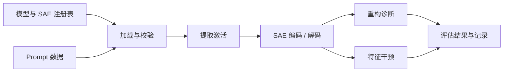

# 🧱 SAEBase：稀疏自编码器研究基础设施

🌍 语言：[English](README.md) | [中文](README_cn.md) &nbsp; [](https://github.com/OpenSAE/SAEBase/actions/workflows/ci.yml)

👉 **一句话总结。** SAEBase 将模型与 SAE 加载、Prompt 数据集、激活分析、特征干预和可复现评估整合为一套公共研究工具。

<p align="center">
  <a href="#-快速上手"><b>🚀 快速上手</b></a> &nbsp; | &nbsp;
  <a href="#-公共-python-api"><b>🔬 Python API</b></a> &nbsp; | &nbsp;
  <a href="#-研究项目接入"><b>🧩 SAR 与 RSS</b></a> &nbsp; | &nbsp;
  <a href="#-文档"><b>📚 文档</b></a>
</p>

---

## 🧭 概览

SAEBase 为学习表征分析、激活层面的量化测量，以及 SAE 特征对下游行为的影响评估提供通用基础设施。



## ✨ 核心能力

- 🧠 **模型与 SAE 管理。** 统一配置模型、checkpoint、层、hook 和兼容性检查。
- 🔎 **激活分析。** 提取激活与 SAE 特征，并计算 L0、激活范数、重构误差和解释方差。
- 🎛️ **特征干预。** 修改 SAE 特征编码，在指定位置写回激活，比较行为输出并保留原始重构残差。
- 🗂️ **可复现数据。** 通过 JSONL 和 manifest 记录模型、行为任务、随机种子及数据版本。
- 🧩 **研究项目接入。** 为 [SAR](https://github.com/OpenSAE/SAE-Behavioral-Compositionality) 与 [RSS](https://github.com/OpenSAE/Redistribution-Sensitivity-Score) 提供公共读取和干预接口，保留各自的原始指标实现。
- ⚙️ **可复用工具。** Python API、命令行、Hydra 配置、自动化测试和 Python 发行包。

---

## ⚙️ 安装

从源码安装标准分析环境（Python 3.11–3.12）：

```bash
git clone https://github.com/OpenSAE/SAEBase.git
cd SAEBase
python -m pip install -e ".[analysis]"
saebase --list
```

<details>
<summary>📦 其他安装方式</summary>

基础安装提供注册表、CLI 和离线公共 API：

```bash
python -m pip install -e .
```

测试与打包使用 `pip install -e ".[dev]"`。GPU 生成后端对应 `.[generation]`，具体环境要求见[运行说明](docs/PHASE_C.md)。

</details>

## 🚀 快速上手

**1. 准备 Prompt 数据**，使用已注册的 Pythia-70M 模型：

```bash
saebase-prepare-prompts \
  --model-key pythia70m --behavior SimpleCopying \
  --device cpu --n-generate 300 --min-kept 20 --seed 0 \
  --data-dir ./data
```

程序在 `data/SimpleCopying/pythia70m/v1/` 下生成 `prompts.jsonl` 和 `manifest.json`。

**2. 评估公开 SAE**，读取第 3 层的激活：

```bash
saebase \
  --task sae --model pythia70m --sae pythia70m_resid_sm \
  --prompt-source SimpleCopying --layer 3 --n-prompts 5 \
  --data-dir ./data --device cpu \
  --run-dir ./experiment/pythia70m-smoke
```

评估结果保存在 `sae_activation_summary.json`，包含逐样本诊断和 Hydra 运行配置。该流程会按需下载公开模型与 SAE 权重。

💻 **端到端验收：** `bash scripts/phase_a_smoke.sh`。GPU 环境可设置 `DEVICE=cuda`。

---

## 🔬 公共 Python API

先运行自包含的**离线示例**，使用小规模合成模型和 SAE：

```bash
python examples/05_public_api_offline.py
```

[`saebase.api`](saebase/api/__init__.py) 提供激活位置、模型适配器、SAE 来源信息、特征读取、编码编辑和干预前后 logits 对比。

特征编辑采用：

```text
edited_activation = original_activation + decode(edited_codes) - decode(original_codes)
```

这一方式保留原激活中的重构残差，并通过原样回放检查模型输出一致性。

真实 Pythia 模型与 SAE 示例：`python examples/06_public_api_pythia.py`。

## 🧩 研究项目接入

SAEBase 提供公共模型操作，各研究项目继续维护自己的指标和实验定义。

| 项目 | SAEBase 提供的能力 | 示例 |
| :--- | :--- | :--- |
| 🧩 **[SAR — 行为组合性](https://github.com/OpenSAE/SAE-Behavioral-Compositionality)** | 提取特征贡献、执行 coalition 干预并调用原始 SAR 估计器。 | [SAR 接入](examples/07_sar_via_saebase.py) |
| 🔀 **[RSS — 表征重分布](https://github.com/OpenSAE/Redistribution-Sensitivity-Score)** | 分别读取 clean、selection、held-out activations 并调用原始 RSS 估计器。 | [RSS 接入](examples/08_rss_via_saebase.py) |

在本地准备好对应研究仓库后运行：

```bash
python examples/07_sar_via_saebase.py --paper-dir /path/to/SAR-repo
python examples/08_rss_via_saebase.py --paper-dir /path/to/RSS-repo
```

两个示例默认使用确定性的合成数据；`--real` 可切换到公开 checkpoint。详见[接入说明](docs/PHASE_C.md)。

---

## 🏗️ 项目结构

| 组件 | 职责 |
| :--- | :--- |
| [`saebase/api/`](saebase/api/) | 模型适配、激活读取、特征编辑与干预结果 |
| [`saebase/sae/`](saebase/sae/) | Checkpoint profiles、SAE 加载和激活诊断 |
| [`saebase/data/`](saebase/data/) | Prompt 准备、兼容性矩阵、JSONL 与 manifest |
| [`models/`](models/) · [`conf/`](conf/) | 模型插件和 Hydra 配置 |
| [`tasks/`](tasks/) · [`scripts/`](scripts/) | 评估任务、数据准备和运行检查 |

## ✅ 验证情况

运行离线测试：

```bash
python -m pip install -e ".[dev]"
python -m pytest -q
```

| 范围 | 验证方式 |
| :--- | :--- |
| 注册表、Prompt 记录和核心 API | 自动化离线测试 |
| 激活读取及干预适配器 | 合成后端与小模型测试 |
| SAR、RSS 接口 | 与原始指标接口的离线契约测试 |
| Pythia / Gemma 公开 checkpoint | 已注册，并提供可选真实模型验收脚本 |
| vLLM / NNsight | 可选实验后端；GPU 实测单独验收 |

<details>
<summary>🔧 运行与兼容性说明</summary>

- 当前打包提供的可执行评估任务为 `task=sae` 与 `activation_health`。
- 其他实验协议配置作为参考保留，其原始任务实现位于研究工作区。
- 真实模型示例按需下载权重，并使用相应的模型、SAE 依赖。
- 注册项可通过 `python -m saebase.sae.verify_registry --list` 查看。
- Python 发行包包含 CLI 入口和版本化 Hydra 配置。

</details>

---

## 📚 文档

[API 文档](docs/API.md) · [入门与数据准备](docs/PHASE_A.md) · [特征干预](docs/PHASE_B.md) · [研究接入](docs/PHASE_C.md) · [更新记录](CHANGELOG.md)

[参与贡献](CONTRIBUTING.md) · [代码来源](docs/PROVENANCE.md) · [发行检查](docs/RELEASE_CHECKLIST.md) · [安全说明](SECURITY.md) · [Apache-2.0 许可证](LICENSE)

<p align="center">
  <b>Open research infrastructure for faithful representation analysis.</b><br>
  <a href="https://github.com/OpenSAE">OpenSAE</a> · <a href="https://github.com/OpenSAE/SAEBase/issues">Issues & contributions</a>
</p>
