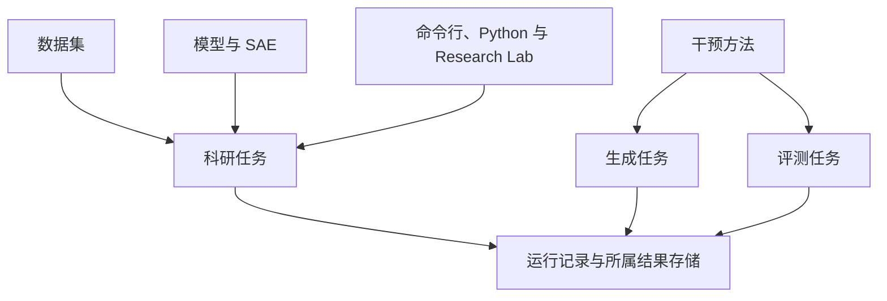

# SAEBase 当前架构

## 目的和主要功能

说明数据集、模型、任务和共同支持的职责，以及增加科研能力时的修改位置。

## 适用范围

适用于当前 SAEBase 科研功能的阅读、开发和维护；使用显式输入和任务配置完成研究工作。

## 组件归属

- `datasets/` 保存数据准备、读取、编码和划分，通过 `saebase.datasets` 导入。数据位置由配置指定；物理组件目录保持独立。
- `models/` 按模型族、系列、实例保存加载与兼容条件。所有已实现的模型通过同一登记入口提供，SAE 资源具有准确的权重、层和 Hook 身份。
- `tasks/` 的八类任务分别拥有科研流程、方法实现与特有产物协议。生成和评测通过干预接口复用测量能力。
- `saebase.api` 提供通用模型、激活位置与 SAE 操作；`saebase.registry`、`saebase.extensions` 提供共同接入。
- `saebase.runtime` 管理共同配置、运行目录和结果记录；`saebase.store` 保存激活、编码、样本身份和缓存。
- Research Lab 使用当前科研接口，Web 依赖通过 `.[lab]` 或其依赖文件安装。基础安装保持科研核心依赖。
- ResearchHarness 通过显式项目绑定提供外部管理，科研算法和基本运行保持独立。

## 添加能力

| 对象 | 主要修改位置 | 接入方式 |
| --- | --- | --- |
| 数据集 | `datasets/<name>/` 和 `conf/dataset/` | 使用现有数据集登记接口，声明真实输入和划分 |
| 模型与 SAE | `models/<family>/<series>/specs.py`、模型配置与 SAE 资料 | 声明加载方法、适用位置和能力；登记资料与真实验证分别表述 |
| 干预方法 | `tasks/intervene/` | 提供明确输入输出，生成和评测使用其接口 |
| 指标与统计 | `tasks/benchmark/` | 使用指标定义、原始方法来源和样本单位 |
| 科研流程 | 对应 Task 的 `operation.py` | 组合已有能力，保留方法特有参数和产物 |



## 制定功能与结果使用

新增或修改 Dataset、Model、Task 和公共支持时，从一个具体的下游使用场景确定功能要交付什么，再安排输入、检查、返回与保存。正常结果支持实际研究操作；失败、受阻和部分完成的结果支持定位问题、补足条件或继续已有工作。需要保留的记录同时设计读取入口及产物定位，检查从正式入口生成、保存后重新读取并实际消费这些内容。各组件通过既有登记、结果与存储接口实现这一过程。

## 运行与结果

共同检查读取组件、路径和种子。训练参数由训练任务检查，激活健康评测是 benchmark 的一种明确用途。科研任务的外层结果使用 `EvaluationResult`，内部测量继续使用所属方法的数据结构。

输出采用 `experiment/<dataset>/<model>/<task>/<run-name>/`，包含 metadata、metrics、checkpoints、tables、figures、logs、reports 和 tmp。metadata 中保存解析后的配置、运行信息和产物目录；失败记录保留异常类型、说明与调用信息。结果中的 `diagnostics` 保存具体原因、任务影响和下一步建议，预检查已有的修复说明直接进入结果。运行内部的产物引用按相对路径保存，读取时基于当前运行目录解析。

`saebase.runtime.experiment_results` 提供 `list_runs`、`read_run`、`compare_runs` 和 `find_reusable_runs`。查询时可传入 `errors=[]` 收集无法读取的记录及其处理建议，其余可读运行继续返回；未传入该参数时通过警告指出异常记录。指标读取复用任务的摘要检查；比较显示各自的模型、SAE、配置和协议，不生成跨指标总分。运行级复用要求调用者提供完整内容身份；已存在的激活缓存、测量账本和训练恢复继续负责各自的校验。

## 功能责任和扩展契约

| 责任方 | 持有的行为 | 调用方的责任 |
| --- | --- | --- |
| Dataset | 样本、划分、编码、输入身份 | 明确选择真实数据及路径 |
| Model 与 SAE | 资源规格、加载、层位与能力 | 通过选择解析和加载接口调用 |
| Task | 参数校验、科研方法、必需工作与比较规则 | CLI、页面和预检查复用任务规则 |
| Runtime | 运行意图、目录、互斥、来源与失败记录 | 不解释具体指标，也不替任务决定科研成功 |
| CLI 与 Research Lab | 输入转换和结果展示 | 读取任务完成摘要，不从报告文件存在推断成功 |

新增任务继承现有 `TaskModule`，实现 `run`；需要提前校验时实现 `validate_cfg`。该方法只解析参数和读取显式输入，不下载权重或启动计算。Runtime 在准备运行目录之前调用它。任务可以实现 `compare_results`；缺省明确返回不支持比较。新增任务通过现有 Registry 登记，不要求修改 Runtime 的科研分支。

`tasks.sae_runtime.resolve_sae` 负责无计算的模型、SAE、层位、Hook 和能力选择，`load_selection` 加载并核对返回身份。预检查和执行共用这两项行为。多层 SAE 需要显式层位或模型配置中的 `default_layers`，单层资源可以使用唯一层位。选择结果记录默认值来源；登记信息与实际权重验证分别表述。

外部提供者通过现有扩展对象和显式 entry point 接入。capture、intervene 与 SAE 预检查检查其实际需要的能力；生成、电路、解释和训练继续要求各自的原生适配。隔离的预检查工作进程通过显式 `task.extensions` 名称重建提供者；不会序列化任意工厂对象或自动发现所有插件。

Dataset 插件可以提供 `prepare` 方法。Precheck 和数据准备 CLI 共用此接口，实际数据生成、Token 附加和过滤继续由 Dataset 自身实现。模型加载通过已有 Model Registry 构造，不再导入已经撤销的平铺模型路径。

Model 插件的 `construct` 保留轻量说明用途；需要真实资源时使用 `load_model(cfg)`，内置登记将它绑定到模型已有加载方法。外部插件未声明单独加载方法时兼容原有构造器。数据准备和 SAE 执行均使用资源加载接口，不能把延迟说明字典当作实际模型。

## 配置、运行意图和结果

- capture 的 `top_feature_num` 由 capture 消费；Task 设备由 `task.device` 选择。模型构造配置中的设备字段保留其构造用途。
- `conf/config.yaml` 是 SAEBase 唯一总控配置，统一组合 model、dataset、task、runtime 和 experiment。Benchmark 与其他任务平级；它不能删除全局输入、控制公共目录或成为其他任务的调度入口。组件配置只描述各自组件。
- Benchmark 的指标和方法参数可以填写在 `task.protocol`，使用全局 model 选择与 dataset 的显式测量样本构造评测。也可读取 `task.benchmark_config` 参数文件；文件中的模型、数据身份必须与全局选择一致，冲突在加载和目录准备之前拒绝。
- 训练的模型和数据快照、设备与精度由 `TrainPlan` 决定；电路的资源由原生 transcoder 配置决定。共同的空 SAE/层位占位字段不参与这些方法，非空值会被拒绝，避免看似可用的参数被忽略。
- 输入文件路径相对于原启动目录解析；不会因 Hydra 切换到产物目录而改变含义。

| 任务 | 生效参数与消费者 | 共同字段的适用范围 |
| --- | --- | --- |
| capture | `operation.capture_top_feature_num` 与捕获接口消费特征数量、提示、位置和设备 | 输入身份记录实际权重、编码输入、方法及位置 |
| intervene | `evaluate_edit` 消费特征编号、替换值和 identity 检查开关 | 设备、提示和 SAE 选择由公共资源接口消费 |
| generate | `Condition`、`GenerationSpec` 消费干预方式、长度、温度及种子 | 仍要求生成后端，通用 capture 对象不等同于支持生成 |
| benchmark | 任务解析指标、条件和协议，backend 或 comparison 执行自身评测 | 遵守全局模型和数据选择；启动种子与协议种子单独记录 |
| circuits | 原生 tracer 消费提示、transcoder、slug、超时及原生选项 | `task.device` 是启动与预检查信息；实际设备策略由原生 tracer 决定 |
| explain | interpretation 消费独立发现集、保留集、位置与预算；选定的 generator 消费生成参数 | 共同 `prompt` 不取代样本文件；自定义 callable 的设备由提供者负责 |
| train | `TrainPlan` 消费快照、设备、精度和训练参数；任务消费超时与大任务开关 | 共同 `device`、`prompt` 不覆盖原生训练计划 |
| precheck | 按模式、对象和预算自动准备缺失依赖、权重及数据，再进入隔离检查 | 实际执行默认尝试安装下载；准备与检查各自记录，不增加二次计算确认 |

原生 circuits、explain、train 的空 SAE、层位及提示占位保持配置兼容，不构成另一套科研输入。添加参数时须在任务校验与消费者之间建立对应关系；不能只在 YAML 中声明参数。

`runtime.mode` 的有效默认值为 `new`：拒绝已有产物。`overwrite` 显式替换经过校验的单个运行目录。`resume` 保留产物并校验配置、显式输入字节与科研源码身份；首批仅支持普通 Benchmark 和模型比较矩阵。改变方法、输入或源码应创建新运行；外层超时预算的变化记录在恢复尝试中。运行锁保存在对应任务的 `_tmp/run_locks`，独占范围包含目录准备、计算和记录。内部账本的 `resume` 不授予删除外层目录的权限。

`EvaluationResult.status` 说明执行状态，`completion` 说明请求完成情况。退出码为 0（成功或仅配置）、1（失败）、2（受阻或不支持而未完成）。数学上未定义的指标保留原因和空值，作为已评估状态记录；模型比较矩阵保留其自身严格的原生验收要求，不因此放宽科研标准。

运行记录保留首次配置、恢复尝试、实际任务结果及错误。`find_reusable_runs` 的返回值是相同已知身份的候选运行，标记 `reuse_authorized=false`；查找命中不会跳过计算。任务账本和缓存继续负责校验实际可复用产物。

Benchmark 比较缺省只匹配相同模型与 SAE；跨资源比较需要明确 `pairs`。比较校验账本，并要求样本与协议身份相同；缺失身份、定义不同或配对多义时明确保留不可比较原因，不自动计算差值。

## 验证归属

`tests/product/test_execution_lifecycle.py` 使用合成提供者验证参数、选择、状态、失败记录、恢复、互斥与身份查询。`test_capture_configuration.py` 验证实际特征数量及加载前拒绝；`test_installed_distribution.py` 使用已有构建后端离线构建、安装，并在仓库外验证配置与任务入口。这些文件属于产品回归，复用现有接口和测试依赖，不引入生产依赖。

源码目录清单的 Atlas 检查归中央集成；普通产品检查不依赖中央目录清单与实际客户端沙箱通过。各类验证的工作资料记录其检查对象、实际结果与依据，按各自负责的功能使用。

## 单一总控与平级任务

```bash
saebase model=openresearch_gemma2_2b_base dataset=ioi task=capture
saebase model=pythia70m dataset=ioi task=benchmark \
  task.benchmark_config=/absolute/path/to/evaluation.json
```

两条命令都使用唯一的 `conf/config.yaml`。默认仅检查配置；实际执行仍需设置 `task.execute=true` 并具备相应资源与授权。用户只选择科研组件和参数，不选择另一份启动总控。已删除专用 Benchmark 启动配置和其他并行总控，没有保留启动别名。

`saebase` 的分发目标是公共 Runtime，`python -m saebase.runtime.train` 使用同一入口。activation-health 工具只转换该评测方法的参数后调用总控，不再承接 SAEBase 主命令。独立指标、审计等科研工具属于功能调用者，不能充当项目管理器。

运行职责是：总控组合配置，Registry 查找组件，Runner 调用选定 Task，Runtime 管理目录、互斥和结果。Dataset 持有样本来源与划分，Model 持有模型和 SAE 资源，Task 持有科研方法及完成条件。Benchmark 内部调用捕获、干预等公共科研函数，不通过其他 Task 类或 Runner 管理任务。

任务专属校验由 `TaskModule.validate_cfg` 持有，是否具备恢复协议由 `supports_run_resume` 声明；公共校验器和生命周期不按 Benchmark 或训练任务名称编写科研分支。

所有任务的目录由 Runtime 根据全局输入统一生成：`experiment/<dataset.name>/<model.name>/<task.path>/<实验名>_<种子>/`。多模型选择在全局 `model.members` 中显式列出，每项有真实 `name`；不同时设置 `model.name`。Runtime 用稳定集合摘要命名目录，完整选择保存在配置与协议中。当前 Benchmark 声明支持多模型；其他任务收到模型集合会明确拒绝，Runtime 不把集合自动展开成其他任务。

`task.protocol` 只接受指标、条件、种子等方法参数。单 SAE 的选择复用已有资源解析，数据从全局 `dataset.samples` 或 `dataset.sample_file` 读取显式 token、目标、位置和 split；Dataset 读取器不生成 token 或推断划分。参数文件不能悄悄覆盖同时提供的全局样本。activation-health 仍是 Benchmark 的评测方法，可通过同一总控组合已有 SAE、PromptSource、evaluation 组件配置。

`tests/product/test_benchmark_launch.py` 验证唯一总控、八个平级任务的共同输入、不可变的全局选择、参数冲突及模型集合能力；安装态检查确认 wheel/sdist 只包含一份顶层总控。完整合成 Benchmark 执行与恢复回归同时检查 Runner 仅分派 Benchmark 本身。


## Capture 的特征选择与组合测量

Capture 使用 `task.top_feature_num` 指定返回的特征数量。`non_whiten` 按原生激活绝对值排序，`whiten` 按所选 Dataset 全 prompt-token 的逐特征 z-score 排序，`sar` 则按原生激活选择特征并测量子集干预后的指定标量行为。

SAR 组合测量归 `tasks/capture/`，直接复用公共 capture、edit、patch API 和用户提供的原版估计器；Benchmark 复用该测量函数，不调用 CaptureTask 或 Runner 分发子任务。样本标签来自 Dataset 或显式 SAR 行为参数，原始子集响应随 capture 产物保存。详细配置及接口迁移见 `interface-migration.md`。

## 精简后的配置与入口

模型声明按族和系列维护，Registry 直接登记实际适配器。数据身份、可用条件及提示产物读写统一由 `datasets/artifacts.py` 提供；自然数据集在所属目录声明差异。组件捕获使用 `saebase.api.components`，解释生成使用 `tasks.explain.interpretation`，Lab 沿用这些正式实现。

`conf/model/`、`conf/sae/`、`conf/dataset/` 和 `conf/prompt_source/` 各以 `catalog.yaml` 保存公共默认值与具名预设。`conf.load_group(group, name)` 供直接调用者读取，Hydra 自带的配置登记保持 `model=... dataset=... +sae=...` 选择方式。Task 和实验协议仍保留各自文件。缺少实际方法的旧评测名称退出配置清单。

普通批次使用 `python -m tasks.capture.matrix`，需等待 GPU 空闲时使用 `scripts/capture_queue.py`；两者共用矩阵配置和正式任务实现。覆盖计划和已有证据汇总使用 `python -m tasks.benchmark.sites.catalog plan` 与 `aggregate`。原阶段专属的执行监督、整批审计交付和固定 LIVE-03 转换程序退出活动能力，普通运行记录、Precheck 审计和当前结果读取继续由各自正式入口提供。


## 科研操作与工程操作

数据准备归根级 `datasets/prepare.py`，通过 `saebase.datasets.prepare` 和现有命令调用。真实模型与 SAE 配对检查归 `tasks/precheck/sae_checks.py`，数值参考归 `saebase/api/reference.py`。存储和干预的真实权重回归分别归已有产品测试，按显式命令启用并保存原比较记录。

两种短评测由 `tasks/benchmark/operation.py` 的同一流程执行，参数保存在 `conf/benchmark/catalog.yaml`，通过现有评测命令选择。已保存证据的核对、读取和资料包组织归 `tasks/benchmark/results/archive.py`。

Lab 的解释、私有工作程序、特征索引、公开包和电路卡片由所属后端承接。工程发布、分发、文档与代码检查由 `scripts/release.py`、`distribution.py`、`documentation.py`、`quality.py` 提供。各入口直接调用所属实现。

## 示例与 Benchmark 的当前布局

完整可运行演示保存于 `scripts/examples/first_experiment.py` 和 `external_providers.py`；合成模型、SAE和受控表示保存于 `tests/fixtures/synthetic.py`。简短调用与操作解释归对应教程，存储、干预与受控输入的完整执行归现有产品测试。

Benchmark 根层保存任务、操作与命令分发，内部按实际流程组织：

| 目录 | 负责功能 |
| --- | --- |
| `execution/` | 协议、计划、缓存复用和测量执行 |
| `metrics/` | 通用指标登记、计算和激活健康评测 |
| `methods/` | SAR、RSS、Localization和原生SAEBench接入 |
| `reliability/` | 样本组重采样、统计比较与已知科研对照 |
| `comparison/` | 多模型、多SAE的评测组织 |
| `sites/` | 位点选择、数值检查、批次调度与恢复记录 |
| `results/` | 测量账本、统计报告、曲线读取、证据核对与资料包 |

SAR继续复用Capture的正式科研实现；方法接入将该能力转换为评测所需的观测。Localization的计算与受控网格归方法，已保存曲线和网格的核对归结果读取。位点目录中的声明、检查、执行和记录各有具体调用者。
