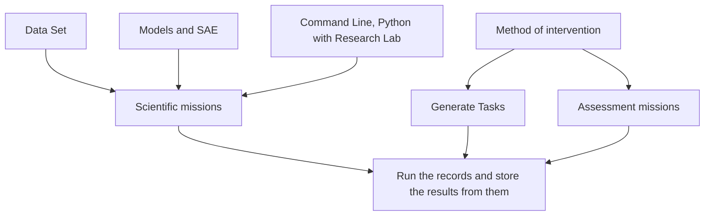

# SAEBase Current Structure

## Purpose

Description of responsibilities for data sets, models, missions and co-support, as well as the location of modifications when increasing scientific capabilities.

## Scope

Read, develop and maintain the current SAEBase scientific function; complete the research with visible input and task configuration.

## Component attribution

- `datasets/` Saves data preparation, reading, coding and partitioning, import by `saebase.datasets`. Data locations are specified by configuration; the physical component catalogue remains independent.
- `models/` Save load and compatibility conditions by model family, series, example. All realized models are available through the same registration entry. SAE resources have precise weights, layers and Hook identities.
- The eight types of missions at `tasks/` have a scientific process, a methodological achievement, and a specific product agreement.
- `saebase.api` provides common models, activated positions and SAE operations; `saebase.registry`, `saebase.extensions` provides common access.
- `saebase.runtime` Manages co-configuration, running directories and records of results; `saebase.store` Saves activation, coding, sample identity and cache.
- Research Lab uses the current scientific interface, and Web relies on the installation via `.[lab]` or on documents.
- ResearchHarness provides external management by binding on visible projects, and scientific algorithms and basic operations remain independent.

## Add Capability

| Object | Organisation | Access |
| --- | --- | --- |
| Data Set | `datasets/<name>/` and `conf/datasets/` | Use of existing data set registration interfaces to state true input and disaggregation |
| Models and SAE | `models/<family>/<series>/specs.py`, model configuration and SAE information | Declaration of method of loading, location of application and ability; description of registration data separately from authenticity |
| Method of intervention | `tasks/intervene/` | Provide clear input and output, generate and evaluate the use of its interface |
| Indicators and statistics | `tasks/benchmark/` | Use of indicator definitions, original methodological sources and sample units |
| Scientific research process | `operation.py` for Task | The combination is capable of retaining the method-specific parameters and products |



## Develop function and result use

When you add or modify Dataset, Model, Task and public support, determine from a specific downstream use scene what functions are to be delivered, and then arrange for input, inspection, return and preservation. Normal results support actual research operations; failed, blocked and partially completed results support positioning problems, make up for conditions, or continue work. Records that need to be kept are designed to read access and locate products, and check for their generation, rereading and actual consumption from the official access.

## Run & Results

The training parameters are checked by a training mission and the health assessment is activated. benchmark A specific use. The results of a scientific mission are used in the outer layer. `EvaluationResult`,Internal measurements continue to use the data structure of the methodology.

The output uses `experiment/<dataset>/<model>/<task>/<run-name>/` to include metadata, metrics, checkpoints, tables, figures, logs, reports and tmp. Metadata saves the profile, running information and product directories after the resolution; fails to record the unusual type, description and call information. In the result `diagnostics` saves the specific cause, task impact and next recommendation, prechecks the restoration description that already exists and goes directly into the result. Operating internal product references are saved on a relative path and are read to be parsed on the basis of the current running directory.

`saebase.runtime.experiment_results` Provides `list_runs`, `read_run`, `compare_runs` and `find_reusable_runs`. When searching, access to `errors=[]` collects unreadable records and suggestions for their handling. The rest of the readable operations continue to return; if this parameter is not passed, indicate an unusual record by warning. Indicators read a summary check of the callback mission; compare their models, SAEs, configurations and protocols and do not generate a cross-indicator total score. Run-level reuse requests full content identification of callers; existing activated caches, measurement books and training resumes responsibility for their respective verifications.

## Functional responsibilities and expanded compacts

| Responsible party | Conduct held | Responsibility of the caller |
| --- | --- | --- |
| Dataset | Samples, division, coding, input identity | Clear selection of real data and paths |
| Model and SAE | Resource specification, load, layer and capacity | Call by selecting the parsing and loading interface |
| Task | Parameter verification, scientific methods, necessity work and comparative rules | CLI, Page & Precheck Reuse Job Rules |
| Runtime | Operational intent, catalogue, cross-reference, source and record of failure | Without explaining specific indicators, and without deciding on the mission's success, |
| CLI and Research Lab | Enter conversion and results presentation | Read a summary of the completion of the assignment without extrapolating success from the existence of the reporting document |

The new task will succeed to the existing `TaskModule` to achieve `run`; it will need to be achieved `validate_cfg` at an earlier check. The method will only parse parameters and read visible input, without downloading weights or starting calculations. Runtime will call it before preparing a running directory. The task will achieve `compare_results`; default returns explicitly without supporting comparison. The new task will be registered through the existing Registry and will not require a change in Runtime's scientific branch.

`saebase.runtime.sae_operations.resolve_sae` is responsible for uncalculated models, SAE, layers, Hook and competency selection, `load_selection` loading and checking back identity. Pre-check and perform shared behaviour. Multi-layer SAE requires `default_layers` in a visible or model configuration, so a single layer of resources can use the only level. Select the result to record the default source; register information is expressed separately from the actual weight.

External providers through existing outreach and visible entry point Access. capture,intervene with SAE precheck capabilities to check their actual needs; generation, wiring, interpretation and training continue to require their respective primary suitability. `task.extensions` Name reconstruction provider; not serializing any plant object or automatically discovering all plugins.

The Dataset plugin provides a `prepare` method. Precheck shares this interface with the Data Preparation CLI, and actual data generation, Token attachments and filters continue to be performed by Dataset itself. Models are loaded by existing Model Registry and no longer import the cancelled flat model path.

Model plugin `construct` retains a light description; `load_model(cfg)` is used when real resources are needed, and the built-in register binds it to the model already loaded. The external plugin does not declare that it is compatible with the original builder when it is loaded separately. The resource loading interface is used for data preparation and SAE implementation, and the delayed description dictionary cannot be used as a practical model.

## Configure, running intent and results

- Capture's `top_feature_num` is consumed by Capture; the Task device is selected by `task.device`. The device field in the model configuration retains its construction use.
- `conf/config.yaml` is the sole master configuration of SAEBase, which combines model, dataset, task, runtime and integration. Benchmark and other tasks lateral; it cannot delete global input, control the public directory or become a schedule entry for other tasks. Component configuration only describes the individual components.
- Benchmark's indicators and methodological parameters can be filled in at `task.benchmark.protocol`, using the global model selection for tectonic tectonic evaluation with a dentaset. You can also read the `task.benchmark.benchmark_config` parameter file; the model, data identity in the file must be consistent with the global selection and the conflict is rejected before loading and cataloguing is prepared.
- The training's models and data snapshots, equipment and accuracy are determined by `TrainPlan`; the resources of the circuit are determined by the original transcoder configuration. The common empty SAE/Strategic biting fields are not involved in these methods, and the non-empty values are rejected, avoiding the neglect of seemingly available parameters.
- Enter the file path to resolve the original startup directory; it does not change meaning by switching Hydra to the product directory.

| Tasks | Entry into force parameters and consumers | Scope of application of common fields |
| --- | --- | --- |
| capture | `operation.capture_top_feature_num` Quantity, hint, location and equipment for consumption characteristics of the capture interface | Enter the actual weight, encoded input, method and location of the identity record |
| intervene | `evaluate_edit` Consumable signature number, replacement value and inspection switch | Device, tip and SAE choose to be consumed by a public resource interface |
| generate | `Condition`, `GenerationSpec` Consumption mode of intervention, length, temperature and seeds | Still requesting to generate backend, generic capture objects are not equivalent to supporting generation |
| benchmark | Task Parsing Indicators, Conditions and Agreements, Backend or Comparison executes their own assessments | Comply with global models and data selection; start a separate record of torrents and protocol seeds |
| circuits | Native trackr consumption tips, transcoder, slug, timeout and primary options | `task.device` is the start-up and pre-check information; the actual equipment strategy is determined by the original trackr |
| explain | Interpretation consumption self-discovery, retention, location and budget; selected consumption generation parameters | Common `prompt` does not replace sample files; customable equipment is the responsibility of the provider |
| train | `TrainPlan` Consumption snapshots, equipment, precision and training parameters; mission consumption timeout switch to large mission | Common `device`, `prompt` does not cover native training programmes |
| precheck | Automatically prepare for loss of dependency, weight and data, by mode, target and budget, before entering the quarantine inspection | Actual implementation of default attempt to install downloads; preparation and checking of respective records without double count confirmation |

The empty SAEs, layers and hints of raw curcuits, extlains, Train remain compatible and do not constitute another set of scientific inputs. The addition of parameters must establish a correspondence between the task verification and the consumer; it cannot be stated only in YAML.

The valid default value for `runtime.mode` is `new`: Refusal of an existing product. `overwrite` Visible replacement of a verified individual operating directory. `resume` Retains the product and validates configuration, visible input bytes and scientific source identities; the first supports only normal Benchmark and model comparison matrices. Changes in methods, inputs or source codes should create new operations; changes in outer time budgets should be recorded in recovery attempts. The running locks are kept at the corresponding task `_tmp/run_locks`, with an exclusive range of catalogue preparation, calculation and recording. The internal ledger `resume` does not grant permission to delete the outer directory.

`EvaluationResult.status` describes the status of implementation, `completion` indicates the completion of the request. The exit codes are 0 (successful or only configuration), 1 (failure), 2 (failed or not supported without completion).

Run records keep the first configuration, try to restore, actual task results and errors. The return value of `find_reusable_runs` is the candidate for the same known identity, marked `reuse_authorized=false`; the search hit does not skip the calculation. The task book and cache continue to verify the actual reusable product.

Benchmark matches only the same model with SAE; cross-resource comparison requires clarity `pairs`. Comparing the account book and requiring that the sample be the same as the protocol; explicitly retaining non-comparable reasons when missing, different definitions or multiple alignments, does not automatically calculate the margin.

## Authenticate attribution

`tests/product/runtime/test_execution_lifecycle.py` Use composite provider to verify parameters, selection, status, failure record, restoration, cross-repeat and identity search. `test_capture_configuration.py` Verify the actual number of features and refuse before loading; `test_installed_distribution.py` Use existing build backend offline to build, install, and verify configuration and mission access outside the warehouse. These documents are product re-entry, re-use existing interfaces and testing, and do not introduce production dependence.

When finding capture codes by purpose and returning, the task rating and result generation is at `tasks/capture/scoring/` and `tasks/capture/outputs/`, respectively. SAE loads and adapts the code at `base/interfaces/sae_adapters/`, separates the language audit from the experimental design at the back end of the research platform. The original Python import path continues to use the same accomplishment. The product test is published by duty organization `tests/product/`, corresponding to the current path for continuous integration. RSS separates the input and analysis scripts; the historical SAR title by data set organization, and formally reads the tool to follow the original title identification.

The list of source directories is based on Atlas; the general product check does not rely on the list of central directories to pass through the actual client sandbox.

## Single master and lateral tasks

```bash
saebase model=openresearch_gemma2_2b_base dataset=ioi task=capture
saebase model=pythia70m dataset=ioi task=benchmark \
  task.benchmark.benchmark_config=/absolute/path/to/evaluation.json
```

The only `conf/config.yaml` is used for both commands. The default is only to check the configuration; the actual execution still requires `task.execute=true` and the corresponding resources and authorization. Users select only scientific components and parameters and not another startup master control. The dedicated Benchmark startup configuration and other parallel master controls have been deleted, and no aliases have been retained.

The distribution target for `saebase` is public Runtime, `python -m saebase.runtime.train`, using the same entry. Activity-health tools only call the master control after converting the parameters of the evaluation method and no longer take the SAEBASE command. Independent indicators, auditing, etc. are functional callers and cannot act as project managers.

Operating duties are: master combination configuration, Registry search component, Runner calls selected Task, Runtme management directories, cross-checks and results. Dataset holds sample sources and classifications, Model holds models and SAE resources, Task holds scientific methods and conditions for completion. Benchmark calls for public scientific functions such as capture, intervention, etc., and does not manage tasks through other Task or Runner.

The exclusive verification of the mission is held by `TaskModule.validate_cfg` and the recovery agreement is declared by `supports_run_resume`; the public examiner and life cycle does not prepare the scientific branch under the name of Benchmark or the training mission.

The directories for all tasks are generated by Runtume based on global input: `experiment/<dataset.name>/<model.name>/<task.name>/<experiment_name>/<run_id>/`. Multimodels choose to be visible in the global `model.members`, each of which is real `name`; and do not set `model.name` at the same time. Multimodels run jointly at `experiment/batches/<task>/<experiment_name>/<run_id>/`, and the members' real identifiers are stored in the configuration and protocol. Benchmark now states that the multiple models are supported; other tasks receive model pools that are clearly rejected, and Runmine does not automatically expand the collection into other tasks.

`task.benchmark.protocol` Only indicators, conditions, torrents, etc. are accepted. The single SAE selects the existing resource resolution, and the data is read from the global `dataset.samples` or `dataset.sample_file` token, target, location and split; the Dataset reader does not generate token or extrapolation. The parameter file does not cover quietly the global sample provided at the same time. Activity-health remains the assessment method for Benchmark, which can be configured with the same master control configuration as the SAE, PromptSource, evaluation component.

`tests/product/benchmarks/test_benchmark_launch.py` Validates single master control, co-input for eight lateral tasks, non-variable global selection, argument conflict and model pooling capacity; installation check confirmed wheel/sdist contains only one top-level master control. Full synthesis Benchmark executes and resumes return while checking Runner assigns Benchmark only.


## Capture feature selection and combination measurement

Capture uses `task.top_feature_num` to specify the number of features to be returned. `non_whiten` Sorts according to the absolute value of primary activation, `whiten` Sorts according to the selected z-score for Dataset all prompt-token, and `sar` selects the characteristics by primary activation and measures the assigned amount of the item behavior after the subset intervention.

SAR combination measurements are classified at `tasks/capture/` and are directly reusable the original estimater provided by the public Capture, edit, Patch API and the user; Benchmark reuses this measurement function without calling CaptureTask or Runner for subtasks. Sample labels are derived from Dataset or visible SAR behavior parameters and original subsets are saved with Capture products. Details of configuration and interface migration are shown at `interface-migration.md`.

## Streamlined configuration and access

Model declaration of maintenance by ethnicity and series, Registry Register the actual adapter directly. `datasets/prompt_collection/artifacts.py` Provides;nature datasets differ in their own catalogues. Component capture is used `saebase.api.components`,Explain Generating Usage `tasks.explain.interpretation`,Lab Follow these formal realizations..

Models, SAEs, datasets and alerts are presets from `conf/models/catalog.yaml`, `conf/base/interfaces/sae_profiles.yaml`, `conf/datasets/catalog.yaml` and `conf/datasets/catalog.yaml`, respectively. `conf.load_group(group, name)` for direct callers to read, and Hydra maintains `model=... dataset=... +sae=...` selections for its own configuration. Task and the experimental protocols retain their own files. The old evaluation name exit list lacks the actual method.

Normal Batch Use `python -m tasks.capture.matrix`,Waiting GPU Use when free `scripts/capture_queue.py`;The two have a common matrix configuration and a formal mandate. `python -m tasks.benchmark.sites.catalog plan` with `aggregate`.Implementation oversight, bulk audit delivery and fixation of original phase exclusive LIVE-03 Convert program exit capability, normal running records, Precheck Audits and access to current results continue to be provided through their respective official portals.


## Scientific and engineering operations

Data are prepared to be called by `datasets/prompt_collection/prepare.py` and by `saebase.datasets.prepare` and existing commands. Real models and SAE pairings are referred to `tasks/precheck/sae_checks.py` and values are referred to `base/interfaces/reference.py`. The real weights of storage and intervention are returned to existing product tests, respectively, and the original comparison records are enabled and maintained by a visible command.

The two short assessments are performed by the same process of `tasks/benchmark/operation.py`, with parameters stored at `conf/tasks/precheck/task.yaml`, selected by the existing evaluation command. The verification, reading and package organization for which evidence has been saved is `tasks/benchmark/results/archive.py`.

The project release, distribution, document and code checks are provided by `scripts/release.py`, `distribution.py`, `documentation.py`, `quality.py`.

## Example with the current layout of Benchmark

Full runable demonstrations are stored at `scripts/examples/first_experiment.py` and `external_providers.py`; synthetic models, SAE and controlled expressions are stored at `tests/fixtures/synthetic.py`. Short calls and operational explanations are assigned to the corresponding tutorials, and full storage, intervention and controlled input are performed for existing product testing.

Benchmark root layer preservation tasks, operations and commands are distributed, organized internally according to the actual process:

| Contents | Responsible function |
| --- | --- |
| `execution/` | Agreements, plans, caches and measurement implementation |
| `metrics/` | Registration, calculation and activation of health assessments for common indicators |
| `methods/` | SAR, RSS, Localization and Native SAEBEnch access |
| `reliability/` | Sample group re-sampling, statistical comparison against known scientific research |
| `comparison/` | Multi-model, multi-SAE assessment organization |
| `sites/` | Bit selection, numeric check, batch movement and recovery of records |
| `results/` | Measuring books, statistical reports, curve reading, evidence reconciliation and information packages |

SAR continues to use Capture's official scientific work; the method of access is used to convert this capability to the observations required for evaluation. The Localization calculation and the controlled grid integration method have saved the cross-references of curves and grids for reading. Declarations, checks, execution and records in the bits directory have specific callers.
